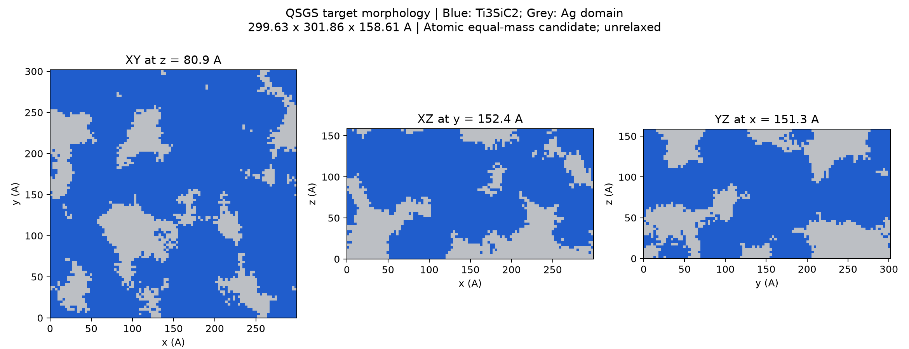
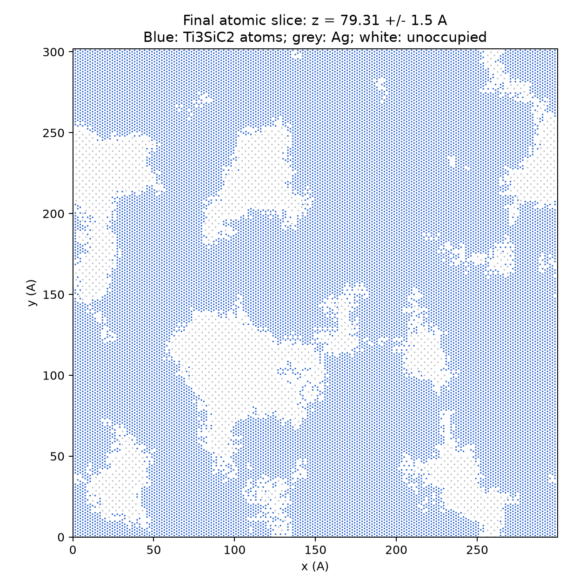

# Ag–Ti₃SiC₂：QSGS 三维双连续初始模型（质量比 1∶1）

**蓝色是 Ti₃SiC₂ 骨架，灰色是 Ag。** 这是新建的、未弛豫初始原子模型，
不是历史 Stage69 模型，也不是已通过 300 K 稳定性验证的结构；没有运行加热或 TTM。





## 查看模型

- **[LAMMPS 原子模型（压缩）](ag_ti3sic2_qsgs.data.gz)**：类型 `1=Ti、2=Si、3=C、4=Ag`，单位 `metal`。
- **[扩展 XYZ 原子模型（压缩）](ag_ti3sic2_qsgs.extxyz.gz)**：包含 `phase`（1=骨架、2=银）及 `fixed_layer`（1=底部固定层）标记。
- **[交互三维形貌](morphology_3d.html)**：下载后在浏览器打开，可旋转、缩放及点击图例切换两相；使用降采样体素表面，非逐原子渲染。
- `qsgs_morphology.npz` 为体素目标形貌。上图第一张表示目标体素域，第二张表示实际原子截面；界面留距和原子清理后两者不完全相同。
- 用 OVITO 打开 `.data.gz` 或 `.extxyz.gz`。按相着色时 Ti/Si/C 统一用蓝色 `#205dcc`，Ag 用灰色 `#bcbfc4`；XYZ 的 `phase` 属性可直接区分两相。

## 最终结构

| 项目 | 数值 |
|---|---|
| 材料尺寸 x×y×z | **299.635 × 301.857484616 × 158.6115 Å** |
| 模拟盒尺寸 | 299.635 × 301.857484616 × 258.6115 Å |
| 顶部真空 | 100 Å |
| 边界 | x、y 周期；z 非周期，上表面自由 |
| 底部固定层 | 0 ≤ z < 10 Å；XYZ 已标记，`in.model` 提供固定约束 |
| 总原子数 | **1,021,793** |
| Ti / Si / C 原子数 | 392,277 / 130,759 / 261,518（全局严格 3∶1∶2） |
| Ag 原子数 | 237,239 |
| Ag∶Ti₃SiC₂ 实际质量比 | **0.9999984966266323∶1** |
| 两相原子连通分量数 | 骨架 1；Ag 1 |
| x、y 周期贯通 | 两相均通过独立周期绕行检验，绕行秩均为 2 |
| z 方向贯通 | 两相的同一连通分量均到达材料底部和顶部邻域 |
| 最短跨相原子距离 | 约 **2.27347 Å** |

按用户允许的晶胞微调尺寸，骨架采用仓库 CIF：
`research/mace-v12-transfer/periodic_interface_v4/v19_cif_parent_structures/source/Ti3SiC2_COD_9009647.cif`。
其晶格参数 a=3.0575 Å、c=17.6235 Å，经正交化后重复 98×57×9，
**骨架面内应变为零**。c 轴沿 z；随机性属于形貌，不代表随机晶粒取向。
Ag 采用 a=4.09 Å 的 FCC 参考晶格；为共享周期盒，x/y 面内匹配应变分别约 +0.3567% / −0.2652%。
尚未计算势函数下的平衡晶格常数，不能把匹配应变视为已弛豫状态。

## QSGS 与质量控制

- 固定随机种子 `20261024`；体素网格 `100×100×50`。
- 生长核心概率 `0.0003`。
- 使用 26 邻域随机生长；各方向概率为 `0.18/邻域格点距离`，在格点方向上对称。
- x/y 生长周期，z 不周期。目标骨架体积分数通过原子化后的质量搜索确定。
- 只生长骨架一种相、Ag 填充补域，因此 QSGS 的多相相互作用生长参数不启用。
- 最终目标体素中骨架约占 65.06%，不是各占 50% 体积；界面留距后按实际原子质量满足 1∶1。
- 体素域分别做面连接检查，孤立小域并入另一相；原子化后再移除孤立原子片段。
- 切割晶格后只从边界删除少量过量骨架原子，保持全局 Ti∶Si∶C=3∶1∶2；不替换元素。
- 银相质量调整使用边界原子裁剪和有连接约束的原晶格位点补回，避免质量校正后产生孤岛。
- 原子近邻图阈值：骨架 3.25 Å、Ag 3.15 Å。连通结论依赖这些明示的几何判据，
  不等于验证细颈力学稳定性或界面热传输。

## 已完成检查与限制

`independent_geometry_validation.json`：重新读入两种导出格式，核对坐标、元素、原子数、
晶胞、质量、化学计量、原子连通和周期绕行。全部通过。

`static_force_check.json` / `.log`：保持仓库候选02势参数不变，LAMMPS 仅做 `run 0`。
未固定底层的力、未施加热浴，因此这里报告的是未经遮蔽的保守势力：

- 势能约 −5,637,607.4 eV。
- 最大力分量约 4.50512 eV/Å；最大原子力矢量模约 **4.51161 eV/Å**。
- 这证明原势能够读取并计算该结构，**不代表结构已经平衡**。后续仍需分阶段弛豫及 300 K 基线验证。

势文件复制自仓库 `current_heating_potential_handoff_20261009`，内容不变：
Ag 用 `Ag_u3.eam`，骨架用 `TSCBOP.tersoff`，跨相用 Morse calibration-v0。
该组合尚未通过生产级验证。没有修改参数、启动 MD、施加电弧或接入 TTM。

## 复现与使用

先解压（保留压缩原件），在本目录操作：

```bash
gzip -dk ag_ti3sic2_qsgs.data.gz ag_ti3sic2_qsgs.extxyz.gz
python validate_geometry.py
# 静态力检查；不积分、不加热：
lmp -in in.geometry_check
```

验证依赖 `ase==3.29.0`、NumPy、SciPy。`build_model.py` 会在脚本所在目录重建文件，
应在独立副本运行以保留这份已上传快照；无需创建 Git worktree。
可视化另需 Matplotlib、Plotly、scikit-image。

当前云环境已测试 Python：`/workspace/.venvs/mace/bin/python`；LAMMPS：
`LD_LIBRARY_PATH=/workspace/.venvs/lammps/lib /workspace/.venvs/lammps/bin/lmp`。
`in.model` 仅定义结构、势、边界和底层约束，不包含平衡或加热流程。

`SHA256SUMS.txt` 可核对本目录交付文件。后续热源和材料电子参数不属于本次模型构建。
