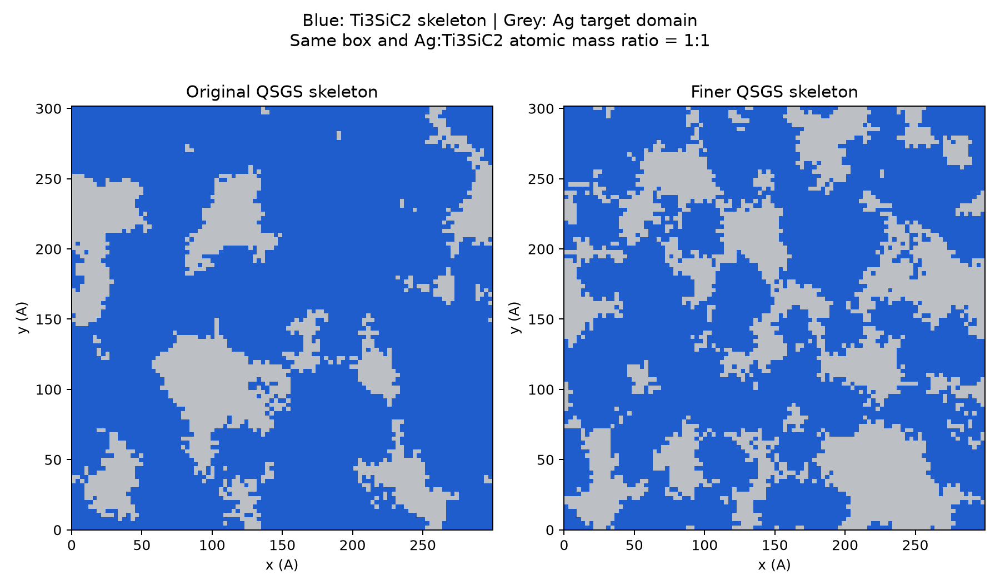
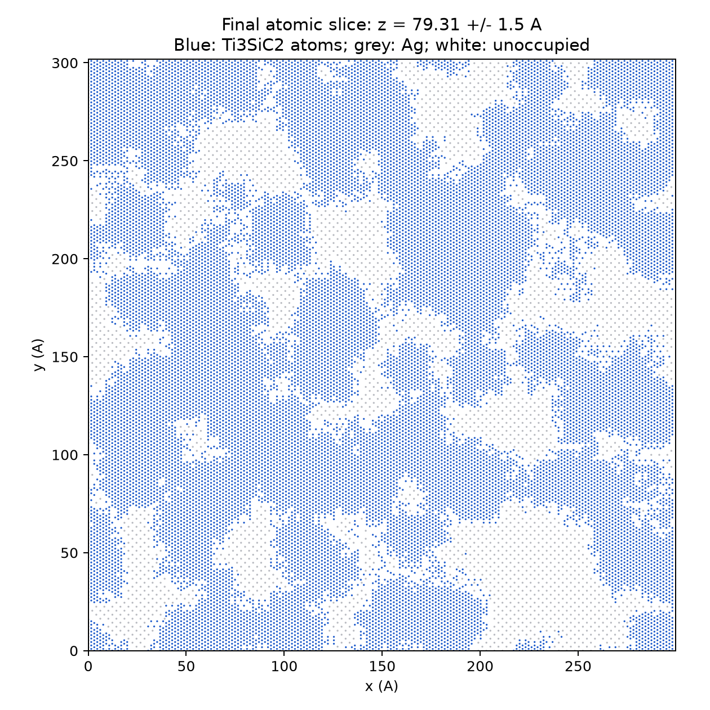

# 骨架细化版：Ag–Ti₃SiC₂ QSGS 三维双连续模型

**蓝色＝Ti₃SiC₂ 骨架，灰色＝Ag。** 根据“骨架再细一点”的要求重新生成。
[原版](../ag_ti3sic2_qsgs_1to1/)完整保留；此版本没有改写原版结构或势参数。





## 下载与查看

- [LAMMPS 原子模型](ag_ti3sic2_qsgs.data.gz)：压缩 `.data`，类型 1=Ti、2=Si、3=C、4=Ag。
- [扩展 XYZ 模型](ag_ti3sic2_qsgs.extxyz.gz)：有 `phase`（1=骨架、2=银）、`fixed_layer` 标记。
- [交互三维形貌](morphology_3d.html)：下载后在浏览器打开，点击图例切换相显示。
- [三方向截面](morphology_sections.png)；[完整几何报告](geometry_report.json)；[独立连通性检查](independent_geometry_validation.json)。

OVITO 可打开上述压缩原子文件。按 `phase` 或元素着色：Ti/Si/C 全部为蓝色 `#205dcc`，
Ag 为灰色 `#bcbfc4`。形貌图表示体素目标域，原子图表示实际原子，界面留距后两者并非完全相同。

## 细化幅度

QSGS 核心概率由 **0.0003 提高至 0.0012**，其余生长方向概率、晶格、盒尺寸、颜色及势参数保持原定义。
增加生长核心密度，使分支更密、形貌尺度更小；并不是直接删除一层骨架原子。
目标体积分数重新搜索，以保证原子化和清理后仍为相同的 **1∶1 质量比**。

| 体素骨架统计 | 原版 | 细化版 |
|---|---:|---:|
| x 向平均截线长度（Å） | 48.00 | 28.85 |
| y 向平均截线长度（Å） | 49.34 | 29.32 |
| z 向平均截线长度（Å） | 43.03 | 27.64 |
| 三方向均值（Å） | 46.79 | 28.60 |

均值下降约 **38.9%**。这是体素域的平均线截统计，不是最小原子细颈直径或力学稳定性判据。
见 `morphology_comparison.json` 与 `compare_morphology.py`。

## 最终原子模型

| 项目 | 细化版结果 |
|---|---|
| 材料 x×y×z（Å） | 299.635 × 301.857484616 × 158.6115 |
| 顶部真空 | 100 Å；模拟盒 z 长 258.6115 Å |
| 边界 | x/y 周期；z 非周期、上表面自由 |
| 底部固定层 | 0≤z<10 Å；`in.model` 提供约束 |
| 总原子数 | **973,985** |
| Ti / Si / C | 373,923 / 124,641 / 249,282，全局严格 3∶1∶2 |
| Ag | 226,139 |
| Ag∶Ti₃SiC₂ 质量比 | **0.9999986082948042∶1** |
| 骨架原子连通分量 | 1 |
| 银原子连通分量 | 1 |
| x/y 周期绕行秩 | 两相均为 2，即均有独立 x/y 贯通 |
| 厚度方向 | 两相的同一连通分量均到达材料两端邻域 |
| 最短跨相原子距离 | 约 2.29556 Å |

骨架使用仓库 COD9009647 CIF，正交化重复 98×57×9，面内不施加应变，c 轴沿 z。
Ag FCC 参考晶格 a=4.09 Å，匹配盒子的 x/y 应变约 +0.3567% / −0.2652%。
形貌是随机的，但晶体取向不是随机多晶。

QSGS 种子为20261024、网格100×100×50，26邻域生长概率为0.18/邻域格点距离。
只生长骨架，银填充补域，因此不启用多相相互作用生长概率。
细化版目标体素骨架比例约62.08%，原子界面留距与边界清理后以实际原子质量校正。
两相都移除孤立小域/片段；银的质量调整保留连通约束；骨架保持全局化学计量。
原子近邻连通阈值为骨架3.25 Å、Ag 3.15 Å。

更细形貌增加界面比例。为避免过近原子，界面留距清理和质量校正后本版本的总原子数减少；
不能把保持质量比等同于保持总质量或界面自由体积。它仍是需要后续弛豫的初始候选。

## 已验证范围

- 两种导出文件重新读入，原子数、元素、坐标、晶胞、化学计量和质量一致。
- 两相的原子连通、x/y 周期绕行及 z 贯通检查通过。
- 仓库原始 EAM + TSCBOP/Tersoff + Morse calibration-v0 完成 LAMMPS `run 0`。
  势能约−5,292,099.6 eV；最大原子力矢量模约 **4.16746 eV/Å**，底层力未遮蔽。
- **尚未弛豫、未通过300 K基线、未运行MD、加热或TTM。** 原势也尚未取得生产级验证结论。

## 复现

```bash
gzip -dk ag_ti3sic2_qsgs.data.gz ag_ti3sic2_qsgs.extxyz.gz
python validate_geometry.py
lmp -in in.geometry_check
```

构建依赖见 `requirements-build.txt`，绘图依赖见 `requirements-visualization.txt`，两者使用独立Python环境。
在独立副本中运行 `build_model.py` 可重建结构，避免覆盖此快照；使用现有checkout，不需要Git worktree。
`in.model` 只定义模型和底层约束，不启动动力学。
`SHA256SUMS.txt` 校验全部交付文件；原版/细化版势文件逐字节相同。
