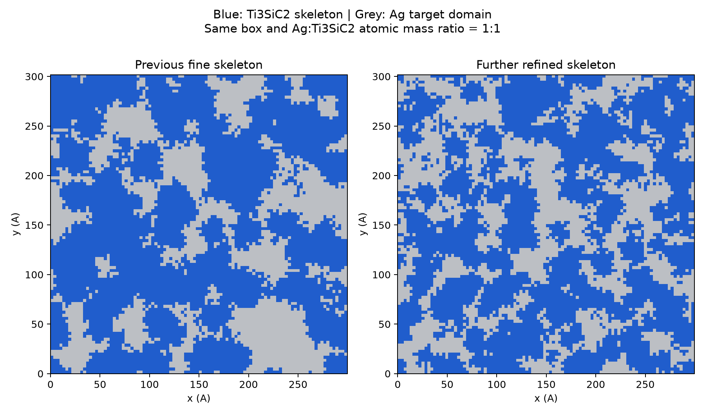
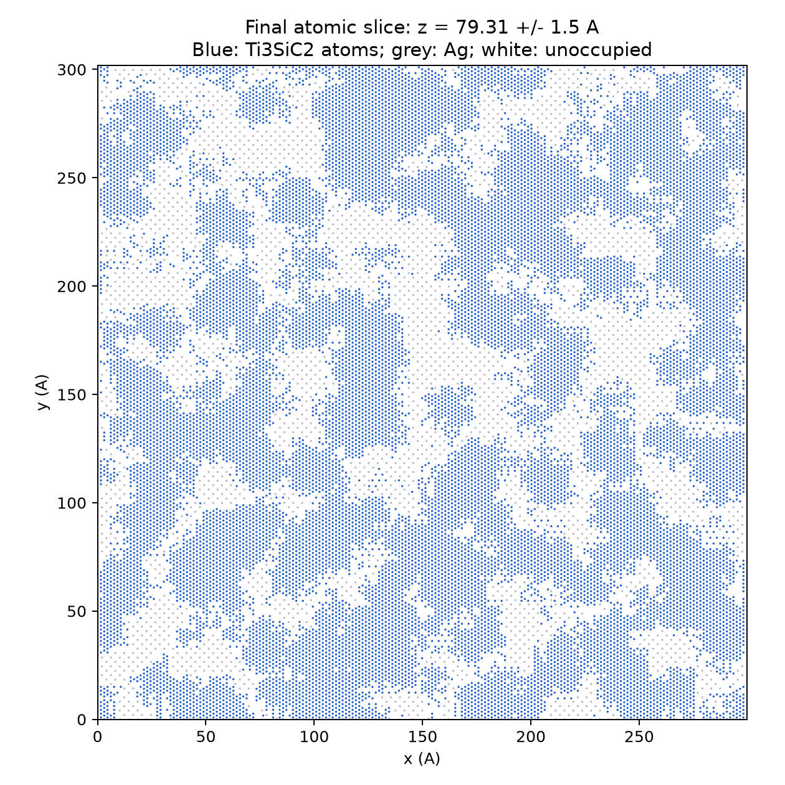

# 再细化版：Ag–Ti₃SiC₂ QSGS 双连续初始模型

**蓝色＝Ti₃SiC₂ 骨架，灰色＝Ag。** 根据第二次“再细一点”的要求生成。
[上一细化版](../ag_ti3sic2_qsgs_1to1_fine/)和[最初版](../ag_ti3sic2_qsgs_1to1/)完整保留。





## 模型与对比

- [LAMMPS模型](ag_ti3sic2_qsgs.data.gz)：类型1=Ti、2=Si、3=C、4=Ag，metal单位。
- [扩展XYZ模型](ag_ti3sic2_qsgs.extxyz.gz)：phase=1骨架、phase=2银；有fixed_layer标记。
- [三维形貌](morphology_3d.html)：下载后浏览器打开；降采样体素表面，不是原子级渲染。
- [三方向截面](morphology_sections.png)、[几何报告](geometry_report.json)、[独立连通验证](independent_geometry_validation.json)。

OVITO打开原子文件后，Ti/Si/C统一蓝色#205dcc，Ag为灰色#bcbfc4。
形貌图是体素目标域，原子图是实际原子；界面留距和清理后两者并不完全相同。

QSGS核心概率从0.0012提高到**0.0032**，增加随机生长核心密度，生成更密的分支。
随机种子20261024、网格100×100×50、26方向生长概率0.18/邻域格点距离。
只生长骨架，因此多相相互作用生长概率不启用。
通过重新搜索目标体积分数、移除孤立小域/原子片段、保持化学计量和有连接约束的银质量校正，
保证更细形貌下仍满足两相原子级连通和1∶1质量比。

体素骨架三方向平均截线长度从**28.60 Å降到19.19 Å**，
较上一版减少**32.9%**。
这是平均线截统计，不是最小原子细颈直径；见morphology_comparison.json。

| 项目 | 本版 |
|---|---|
| 材料尺寸（Å） | 299.635 × 301.857484616 × 158.6115 |
| 顶部真空/盒z长 | 100 Å / 258.6115 Å |
| 边界 | x/y周期，z非周期；底部0≤z<10 Å固定、顶部自由 |
| 总原子数 | **917,378** |
| Ti/Si/C | 352,191 / 117,397 / 234,794；严格3∶1∶2 |
| Ag | 212,996 |
| Ag∶Ti₃SiC₂质量比 | **0.999998391820∶1** |
| 两相原子连通分量 | 骨架1、Ag 1 |
| x/y周期绕行检验 | 两相绕行秩均为2 |
| z贯通 | 两相单一连通分量均到达材料两端邻域 |
| 最短跨相距离（Å） | 2.33235 |

骨架仍使用仓库COD9009647 CIF，正交重复98×57×9，c轴沿z、面内零应变。
Ag采用a=4.09 Å FCC晶格，面内匹配应变约+0.3567%/−0.2652%。
随机的是形貌，不是晶粒取向。连通判据近邻阈值为骨架3.25 Å、Ag 3.15 Å。
体素骨架比例为58.335%；质量比以最终实际原子质量核算。

更细结构的界面比例更高，界面留距清理后总原子数和界面自由体积会变化；
保持质量比并不代表保持总质量。这里没有用势函数优化来消除界面自由体积。

## 验证范围

导出格式重新读入、坐标/元素/晶胞/化学计量/质量、两相原子连通、周期绕行与厚度贯通均通过。
原版仓库EAM + TSCBOP/Tersoff + Morse calibration-v0逐字节复制，未修改势参数。
LAMMPS仅run 0，最大原子力矢量模约**3.98779 eV/Å**，底层力未遮蔽。
**仍为未弛豫初始几何，未验证300 K稳定性，未运行MD、加热或TTM。**
细颈力学稳定性和生产级势验证不在这次几何检查结论内。

另有一个与 Ag/界面分开的 Ti₃SiC₂ 母相 TSCBOP 静态晶胞检查，输入、日志和结果见[独立检查记录](potential_validation/ti3sic2_bulk_tscbop/README.md)。母相晶体可在该势下弛豫到低力状态；各向异性零压弛豫后的晶胞比 CIF 初始尺寸大约 0.5–0.8%。这项结果不等于 QSGS 骨架或复合冷态基线通过，也没有将弛豫晶胞代入复合模型。

```bash
gzip -dk ag_ti3sic2_qsgs.data.gz ag_ti3sic2_qsgs.extxyz.gz
python validate_geometry.py
lmp -in in.geometry_check
```

构建和绘图依赖分别见requirements-build.txt、requirements-visualization.txt，使用独立Python环境。
build_model.py在脚本所在目录重建文件；在独立副本中运行以保留本快照，使用现有checkout、不需Git worktree。
in.model只定义结构、势和底部约束，不启动动力学。SHA256SUMS.txt核对交付文件。
