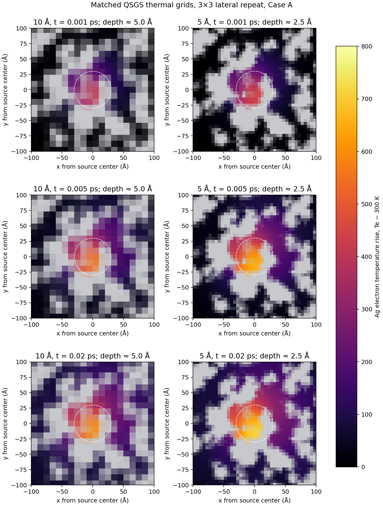

# Matched 5 Å/10 Å QSGS localization screen at 0.02 ps

## Scope and fixed conditions

This is a matched, short continuum two-temperature/enthalpy comparison. It uses the existing 3×3 lateral repeat of the same QSGS unit cell, boundary case A, no bottom heat sink, the exact QSGS Ag face-contact conduction graph, the binary-geometry-integrated source, and the unchanged candidate Ag electron properties. The source remains \(I_0=5\) eV/(ps·Å²), \(R=30\) Å with \(\exp(-r^2/R^2)\), and \(l_{skin}=20\) Å. Both grids use \(dt=0.3125\) fs and heat for 0.02 ps (20 fs). Snapshots are saved at 1, 5, and 20 fs; the CSV histories contain 1 fs energy-accounting intervals.

The 3×3 cell is a periodic repeat of the same QSGS geometry, not an independently generated larger random sample. This screen checks grid response only. It does not test melting or solidification physics.

## Conservative field mapping

The 5 Å cell-averaged fields are mapped onto the 10 Å cells using exact axis-aligned overlap-volume averages. The mapped fields include electron energy density, Ag lattice enthalpy density, cumulative signed electron-to-lattice transfer density, and liquid Ag volume density. Effective electron temperature is recovered by inverting the candidate \(U_e(T_e)\) table after dividing by the mapped Ag fraction; effective lattice temperature and liquid fraction are recovered from the mapped Ag-specific enthalpy.

The 5 Å and 10 Å cell partitions are not nested along y: their grids have 183 and 93 cells, respectively. The mapped Ag fractions conserve total Ag volume but differ locally from the directly projected 10 Å fractions: relative L1 difference 3.075% of Ag volume, maximum absolute cell-fraction difference 0.1292. This projection difference is recorded and not corrected by renormalizing either field.

## Run results

| Time | Electron peak, 10 Å / 5 Å (K) | Ag-weighted electron q99.9, 10 Å / 5 Å (K) | Peak lattice temperature, 10 Å / 5 Å (K) | Cumulative electron→lattice transfer, 10 Å / 5 Å (J) | Liquid Ag fraction |
|---:|---:|---:|---:|---:|---:|
| 1 fs | 705.90 / 743.51 | 420.38 / 425.54 | 300.00268 / 300.00288 | 4.727×10⁻²² / 4.672×10⁻²² | 0 / 0 |
| 5 fs | 854.87 / 957.94 | 526.67 / 555.64 | 300.02330 / 300.02686 | 1.178×10⁻²⁰ / 1.152×10⁻²⁰ | 0 / 0 |
| 20 fs | 898.46 / 1015.63 | 576.86 / 617.57 | 300.11152 / 300.13250 | 1.927×10⁻¹⁹ / 1.899×10⁻¹⁹ | 0 / 0 |

At 20 fs the raw electron peak differs by 13.04%, the raw Ag-weighted q99.9 differs by 7.06%, and the Ag volume above 305 K differs by 5.02 percentage points. The 5 Å to 10 Å mapped central half-rise hotspot diameters are close: 55.95 Å versus 56.03 Å (0.13% difference). This shows that hotspot extent is stable while peak and high-temperature-tail measures remain resolution-sensitive.

At 20 fs the central-tile conservative-mapping comparison gives a 10.44% relative L1 difference in electron energy density, 8.76% in lattice enthalpy density, and 8.76% in the cumulative local coupling map. The Ag-weighted absolute electron-temperature difference has a 5.40 K mean and 18.46 K q95. The Ag-weighted lattice-temperature difference remains small (0.00242 K q95, 0.02443 K maximum), but this does not erase the spatial enthalpy and coupling-map differences.

To separate the projected phase-mask mismatch from intensive-field differences, electron energy was divided by each grid's mapped Ag fraction, its 300 K baseline was removed, and the two results were compared using the common-Ag-volume proxy `min(phi_10A, phi_5A→10A)` as the weight. At 20 fs this still gives a 9.74% relative L1 difference in excess electron energy per Ag volume; common-Ag-weighted lattice enthalpy and coupling maps differ by 7.70%. These exceed 5%, so the temperature-dependent energy field remains resolution-sensitive after first-order phase-fraction normalization. The common-volume weighting is based on projected cell fractions, not an exact subcell intersection, and is therefore a diagnostic rather than a replacement for a geometry-exact common-grid transfer.

Within each run, the local cumulative electron-to-lattice transfer agrees with the lattice enthalpy field cell-by-cell to relative L1 below \(2.7\times10^{-14}\), as expected for case A with zero Ag lattice conductivity. The total coupled source energy is \(1.77243584846\times10^{-17}\) J in both runs. Relative total-energy residuals are \(2.27\times10^{-15}\) (10 Å) and \(2.38\times10^{-15}\) (5 Å). The two integrated source powers differ by only \(2.45\times10^{-16}\).



The gray background is the non-Ag part of the projected geometry; color shows Ag electron temperature rise above 300 K at a near-surface slice (about 5.0 Å for 10 Å cells and 2.5 Å for 5 Å cells). The dashed circle marks the 30 Å Gaussian radius.

## Convergence decision

The heat-source integral, global energy ledger, and local electron-to-lattice energy bookkeeping pass. The mapped half-rise hotspot diameter also agrees closely. However, the previously set 5% spatial screen is not met: the raw electron peak differs by 13.04%, q99.9 by 7.06%, the fixed \(T_e\ge305\) K volume fraction by 5.02 percentage points, the central electron-energy-density map by 10.44%, and the central lattice-enthalpy/coupling maps by 8.76%.

Therefore the 0.02 ps comparison does **not** pass spatial convergence. Do not extend these runs to 0.05 or 0.1 ps yet, and do not treat the fine-grid raw peak as the answer. The lattice remains below 300.14 K and there is no liquid Ag, so this remains a numerical localization result rather than an incipient melt pool.

The next step is to resolve the grid-sensitive field distribution without changing the source or material properties. First examine whether the remaining difference is dominated by the non-nested projected phase geometry or by the temperature-dependent electron-energy field itself. If necessary, use a common refinement grid or a geometry-aware overlap transfer and validate that transfer on the binary QSGS mask before repeating the 0.02 ps pair. Only after the agreed spatial criteria pass should the matched calculation advance to 0.05 ps.

## Reproduction

Run from the model directory:

```bash
python phase_field_qsgs/qsgs_ttm_enthalpy.py --spacing 10A --boundary A --heat-ps 0.02 --cool-ps 0 --dt-fs 0.3125 --sample-ps 0.001 --snapshot-ps 0.001,0.005,0.02 --tile-xy 3 --face-contacts phase_field_qsgs/qsgs_ag_face_contacts_10A.npz --output phase_field_qsgs/qsgs_localization_matched_3x3_10A_0p02ps_dt0p3125fs.csv
python phase_field_qsgs/qsgs_ttm_enthalpy.py --spacing 5A --boundary A --heat-ps 0.02 --cool-ps 0 --dt-fs 0.3125 --sample-ps 0.001 --snapshot-ps 0.001,0.005,0.02 --tile-xy 3 --face-contacts phase_field_qsgs/qsgs_ag_face_contacts_5A.npz --output phase_field_qsgs/qsgs_localization_matched_3x3_5A_0p02ps_dt0p3125fs.csv
python phase_field_qsgs/analyze_matched_grid_fields.py
python phase_field_qsgs/plot_source_grid_comparison.py --coarse-fields phase_field_qsgs/qsgs_localization_matched_3x3_10A_0p02ps_dt0p3125fs_fields.npz --fine-fields phase_field_qsgs/qsgs_localization_matched_3x3_5A_0p02ps_dt0p3125fs_fields.npz --times-ps 0.001,0.005,0.02 --output phase_field_qsgs/qsgs_localization_matched_3x3_0p02ps.png
python -m unittest discover -v
```

CSV histories, JSON summaries, conservative field-comparison metrics, and full 3D field snapshots are stored beside this report. `analyze_matched_grid_fields.py` documents and reproduces the overlap remap and energy-based temperature reconstruction.
