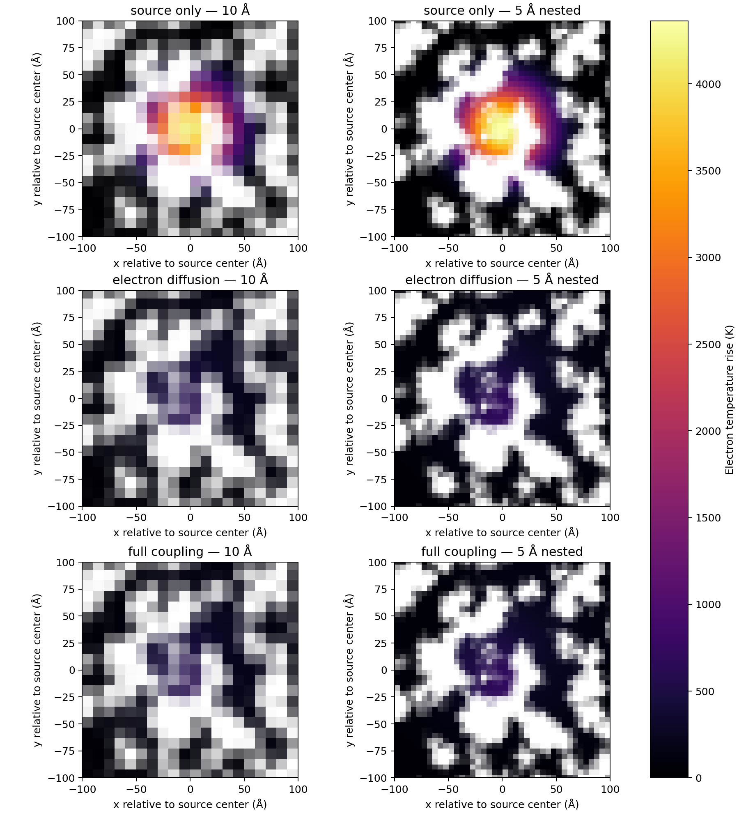

# Strictly nested QSGS grid and transport ablation at 0.02 ps

## Decision

The strict 5 Å/10 Å comparison removes the earlier non-nested-grid phase and source mapping discrepancy, but it does **not** pass the 5% spatial screen once electron conduction is enabled. The source-only mapped fields agree to roundoff; electron conduction produces a 10.72% common-Ag-weighted L1 difference in excess electron energy, and the full two-temperature case produces a 9.88% difference in lattice enthalpy. Do not extend this comparison to 0.05 ps yet. No liquid Ag is present at 20 fs.

## Fixed setup

The original 100×100×50 QSGS binary morphology, seed, physical dimensions, boundary case A, 3×3 lateral repeat, source and candidate material properties are unchanged. The thermal grids are now exactly nested:

| Grid | Base-cell shape | 3×3 run shape | Relationship |
|---|---:|---:|---|
| 10 Å | 30×31×16 | 90×93×16 | Coarse reference |
| 5 Å nested | 60×62×32 | 180×186×32 | Exactly two cells per coarse cell on every axis |

Because the physical box lengths are not integer multiples of 10 Å, the cells have slightly anisotropic widths. The fine spacings are exactly half the coarse spacings: coarse ((9.98783, 9.73734, 9.91322)) Å and fine ((4.99392, 4.86867, 4.95661)) Å.

Both grids use (I_0=5\) eV/(ps·Å²), (R=30\) Å with `exp(-r²/R²)`, (l_{skin}=20\) Å, (dt=0.3125\) fs, no bottom heat sink, and the exact QSGS Ag face-contact graph. The 5 Å grid from the prior non-nested comparison remains untouched and is not used in these runs.

## Geometry and source transfer audit

The phase mask is projected directly from the same binary QSGS voxels onto both target shapes. The fine Ag fractions, averaged in 2×2×2 blocks, reproduce the 10 Å fractions with relative L1 error (4.81\times10^{-16}) and maximum cell-fraction difference (2.44\times10^{-15}). The source-integral map also coarsens exactly: relative L1 difference (1.10\times10^{-16}). Both integrated source powers are 0.886217924226 mW.

The exact binary-geometry Ag contact areas on the fine faces, area-averaged onto the corresponding coarse faces, agree with the directly computed 10 Å contact fractions to maximum absolute error below (3.0\times10^{-15}); the relative area-weighted L1 differences are below (6.1\times10^{-16}). Thus the nested grid comparison no longer has a material geometry, source-integral, or face-contact mapping discrepancy.

## Staged 20 fs results

The three modes are diagnostic ablations, not separate physical models. “Source only” disables electron diffusion and electron–lattice coupling. “Electron diffusion” enables electron conduction but disables coupling. “Full coupling” enables both. Case A has zero Ag lattice conductivity, so these stages isolate the source, electronic transport, and energy transfer without changing material values.

| Mode | 10 Å electron peak | 5 Å nested electron peak | Common-Ag excess electron-energy L1 | Common-Ag lattice-enthalpy L1 | Liquid Ag |
|---|---:|---:|---:|---:|---:|
| Source only | 4417.97 K | 4662.92 K | (1.72\times10^{-14}) | 0 | 0 |
| Electron diffusion | 899.24 K | 1014.83 K | 10.72% | 0 | 0 |
| Full coupling | 898.46 K | 1013.91 K | 10.72% | 9.88% | 0 |

The source-only ablation is intentionally unphysical: it injects energy without diffusion or lattice transfer. Its native fine-grid peak is 5.54% above the coarse peak, but after conservative 5 Å→10 Å mapping the electron-temperature and excess-energy fields agree to roundoff. This shows that the native peak alone reflects subcell resolution and is not a sufficient convergence metric.

The reported common-Ag energy and enthalpy L1 values cover the full 3×3 tiled domain; the Ag-weighted electron/lattice temperature-difference quantiles and hotspot diameters are measured in the central QSGS unit cell.

After electron diffusion is enabled, the native peak difference grows to 115.59 K (12.85% of the 10 Å peak; 19.29% relative to its rise above 300 K). The Ag-weighted q99.9 is 577.61 K versus 621.61 K, a 7.62% difference. The central hotspot diameter remains closer: 56.81 Å at 10 Å and 57.34 Å after mapping the fine result to the coarse grid.

With full coupling, the 10 Å and nested 5 Å lattice peaks are 300.112 K and 300.132 K. The maximum common-Ag-weighted absolute lattice-temperature difference is only 0.0254 K, while the local lattice enthalpy/coupling map still differs by 9.88% relative L1. The total energy residuals are (-4.02\times10^{-32}) J and (-3.81\times10^{-32}) J, about (2.27\times10^{-15}) and (2.15\times10^{-15}) relative to the source energy. Both grids transfer about 1.07% of the injected energy to the lattice by 20 fs.



## Interpretation and next step

The non-nested geometry and source transfer were real confounders in the prior comparison, but they do not explain the remaining mismatch: the source-only field maps exactly after coarsening, while enabling electronic diffusion raises the common-Ag field error above 10%. The unresolved error is therefore in the spatial transport discretization or its interaction with the nonlinear temperature-dependent electron properties, not missing source energy or an incorrect phase-mask transfer.

The 5% spatial criterion still fails, despite energy conservation and close hotspot size. The 20 fs runs remain a localization and discretization study; they do not produce a melt pool. Do not raise the heat input or change the candidate material properties to force agreement. The next numerical task is to inspect the finite-volume conductance and temperature-dependent (k_e/C_e) response on the nested mesh, then perform a targeted spatial/time-step convergence check. The complete 3×3, 5 Å, 20 fs full-coupling case took about 35 minutes in this environment, so optimizing the diffusion/coupling implementation is also necessary before repeating many fine-grid scans.

## Reproduction

Run from the model directory. Grid generation writes separate `_nested` files and leaves the previously used 5 Å projection untouched:

```bash
python phase_field_qsgs/generate_nested_qsgs_grids.py
python phase_field_qsgs/run_nested_grid_diagnostics.py
python -m unittest discover -v
```

The script writes one CSV history for each mode/grid pair, the combined JSON/CSV metrics, and the comparison image under `phase_field_qsgs/nested_grid_diagnostics/`. The complete settings, geometry audit, and per-snapshot metrics are recorded in `nested_grid_20fs_mode_comparison.json`.
