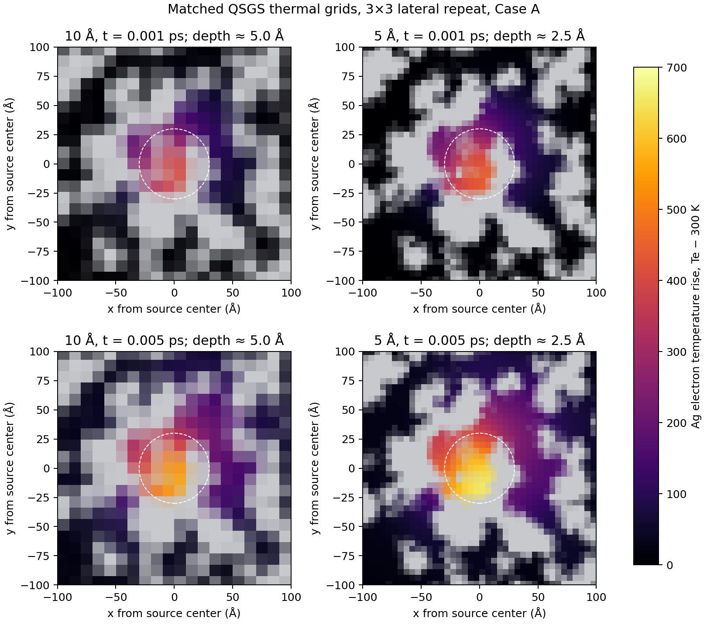

# QSGS source integration and short-grid comparison

## Scope

This screen isolates source discretization, thermal-grid resolution, time-step sensitivity, and lateral periodic-domain size. It is not a melting calculation. Every run is a continuum two-temperature/enthalpy calculation with boundary case A, no bottom heat sink, exact QSGS Ag face-contact fractions for electron conduction, and a 5 fs source pulse. No Ag liquid fraction appeared.

The source remains

\[
Q_e(r,d)=\frac{I_0}{l_{\rm skin}}\exp(-r^2/R^2)\exp(-d/l_{\rm skin}),
\]

with \(R=30\) Å, \(l_{\rm skin}=20\) Å, and peak flux \(I_0=5\) eV/(ps·Å²) = \(8.01088317\times10^{13}\) W/m². It is not renormalized to recover power removed by the Ag geometry mask.

## Source integration change

The old cell-center estimate is replaced, for runs with the saved binary geometry, by an analytic integral over the intersection of each thermal cell and the original binary QSGS Ag voxels. The x/y Gaussian factors use error-function integrals; the depth exponential is integrated analytically. The implementation is in [`qsgs_source_integration.py`](qsgs_source_integration.py), and `qsgs_ttm_enthalpy.py` records the cell-integrated source map in field snapshots.

Projected cells with Ag fraction below \(10^{-12}\) are round-off-only cells. Their integrated source is omitted rather than sent into a cell with no active Ag heat capacity. The largest omitted power in the 5 Å/10 Å comparison is \(1.71\times10^{-19}\) W, less than \(2.0\times10^{-16}\) of the total.

For the same 3×3 lateral repeat, the integrated source power is:

| Thermal grid | Grid shape | Integrated power (W) | Energy over 5 fs (J) |
|---|---:|---:|---:|
| 10 Å | 90×93×16 | 8.862179242281309×10⁻⁴ | 4.431089621140655×10⁻¹⁸ |
| 5 Å | 180×183×32 | 8.862179242281307×10⁻⁴ | 4.431089621140655×10⁻¹⁸ |

The 10 Å versus 5 Å power difference is \(2.45\times10^{-16}\) relative. Repeating the same geometry once versus three times laterally changes the integrated power by less than \(2.8\times10^{-12}\) relative. This confirms grid-independent source integration for the current geometry and source definition.

## Matched 5 Å/10 Å runs

Both calculations use the same 3×3 periodically repeated QSGS domain (898.905×905.572×158.612 Å), source, boundary, conduction graph, 0.3125 fs step, and 5 fs heating interval. Values below are at 5 fs. Temperature percentiles and volume fractions are Ag-volume-weighted.

| Metric at 5 fs | 10 Å | 5 Å | Change, 5 Å relative to 10 Å |
|---|---:|---:|---:|
| Electron peak (K) | 854.870 | 957.943 | +12.06% |
| Ag-weighted electron mean (K) | 303.532 | 303.458 | −0.074 K |
| Ag-weighted electron q90 (K) | 306.811 | 305.686 | −0.37% |
| Ag-weighted electron q99 (K) | 361.172 | 365.251 | +1.13% |
| Ag-weighted electron q99.9 (K) | 526.668 | 555.642 | +5.50% |
| Ag volume with \(T_e\ge305\) K | 12.007% | 10.746% | −1.261 percentage points |
| Half-rise electron hotspot diameter (Å) | 53.719 | 52.712 | −1.87% |
| Peak Ag lattice temperature (K) | 300.0233 | 300.0269 | +0.0036 K |
| Ag liquid volume fraction | 0 | 0 | — |

The energy residual is \(6.69\times10^{-33}\) J at 10 Å and \(8.57\times10^{-33}\) J at 5 Å, around \(2\times10^{-15}\) of the source energy. The energy ledger closes, but that does not establish spatial convergence.

The near-surface Ag electron-temperature slices are shown below. Gray indicates cells without Ag source geometry; the dashed circle marks the 30 Å Gaussian radius. The 5 Å map resolves the same morphology at finer scale but still has a higher local peak.



The bulk-weighted mean, q90, q99, thresholded volume, and hotspot diameter are close at this early time. The electron maximum differs by 12.1%, and q99.9 differs by 5.5%; these tail-sensitive quantities are not grid-converged under a 5% screen. Therefore this is a partial agreement, not a passed spatial-convergence gate. No molten region is present, and the 5 fs lattice response is still only about 0.03 K above 300 K.

## Time-step check

For 10 Å on the same 3×3 domain, halving the step from 0.3125 fs to 0.15625 fs changes the 5 fs electron peak by −1.28%, q99 by +0.08%, q99.9 by −0.37%, the half-rise diameter by +0.85%, and the \(T_e\ge305\) K Ag volume fraction by +0.044 percentage points. The peak lattice temperature changes by \(-0.00030\) K. The energy residual remains below \(1.4\times10^{-32}\) J. The early 10 Å transient is thus time-step-stable under these indicators; this does not validate a longer-time or melting trajectory.

## Lateral domain-size check

At 10 Å and 0.3125 fs, compare the original 1×1 lateral cell (299.635×301.857×158.612 Å) with the 3×3 periodic repeat. The central-source power and local peak are almost unchanged: 0.0008862179242257 W and 855.35 K for 1×1, versus 0.0008862179242281 W and 854.87 K for 3×3. The 5 fs half-rise hotspot diameter is 53.719 Å in both.

However, the whole-domain Ag-weighted electron mean is 331.77 K in the 1×1 cell and 303.53 K in the 3×3 cell; the fraction of Ag above 305 K is 100% versus 12.0%. This confirms that the original 30 nm periodic box makes global heating statistics strongly size-dependent. The 3×3 repeat is preferable for local-source screening, although it repeats the same QSGS morphology and is not an independent larger random sample. At this very early time, the central local hotspot metrics are similar; larger-domain effects should be reassessed for longer pulses.

## Gate and next step

For the next convergence campaign, use these operational screens: source power variation below 1%; relative energy residual below \(10^{-10}\); time-step refinement below 2% for peak and percentile temperatures and hotspot diameter; and spatial refinement below 5% for the electron peak, q99, q99.9, and hotspot diameter, with the fixed-threshold liquid/heating volume differing by less than 2 percentage points. These are numerical project tolerances, not material constants. The current runs pass source integration, energy bookkeeping, and the 10 Å time-step check, but fail the strict spatial screen because of the peak and q99.9 tails.

Next, keep the same source, domain, and face-contact graph and run a longer *numerical localization* comparison on 5 Å and 10 Å before using either grid for a melt-pool claim. If runtime makes 5 Å impractical, optimize the solver or use a smaller matched region while preserving the source geometry; do not tune the physical conductivity to force agreement. Once spatial convergence is acceptable, proceed to a heating/cooling study. The present results show no Ag melting and do not establish melt-pool formation, condensation, or a converged 3D thermal field.

## Reproduction

Run from the model directory:

```bash
python phase_field_qsgs/qsgs_ttm_enthalpy.py --spacing 10A --boundary A --heat-ps 0.005 --cool-ps 0 --dt-fs 0.3125 --sample-ps 0.001 --snapshot-ps 0.001,0.005 --tile-xy 3 --face-contacts phase_field_qsgs/qsgs_ag_face_contacts_10A.npz --output phase_field_qsgs/qsgs_source_gridcompare_3x3_10A_dt0p3125fs.csv
python phase_field_qsgs/qsgs_ttm_enthalpy.py --spacing 5A --boundary A --heat-ps 0.005 --cool-ps 0 --dt-fs 0.3125 --sample-ps 0.001 --snapshot-ps 0.001,0.005 --tile-xy 3 --face-contacts phase_field_qsgs/qsgs_ag_face_contacts_5A.npz --output phase_field_qsgs/qsgs_source_gridcompare_3x3_5A_dt0p3125fs.csv
python phase_field_qsgs/qsgs_ttm_enthalpy.py --spacing 10A --boundary A --heat-ps 0.005 --cool-ps 0 --dt-fs 0.15625 --sample-ps 0.001 --snapshot-ps 0.001,0.005 --tile-xy 3 --face-contacts phase_field_qsgs/qsgs_ag_face_contacts_10A.npz --output phase_field_qsgs/qsgs_source_gridcompare_3x3_10A_dt0p15625fs.csv
python phase_field_qsgs/qsgs_ttm_enthalpy.py --spacing 10A --boundary A --heat-ps 0.005 --cool-ps 0 --dt-fs 0.3125 --sample-ps 0.001 --snapshot-ps 0.001,0.005 --tile-xy 1 --face-contacts phase_field_qsgs/qsgs_ag_face_contacts_10A.npz --output phase_field_qsgs/qsgs_source_domaincompare_10A_tile1_dt0p3125fs.csv
python phase_field_qsgs/plot_source_grid_comparison.py
python -m unittest discover -v
```

The corresponding CSV time histories, JSON summaries, and compressed 3D field snapshots are stored beside this report. The source integration checks are in [`../test_qsgs_source_integration.py`](../test_qsgs_source_integration.py).
