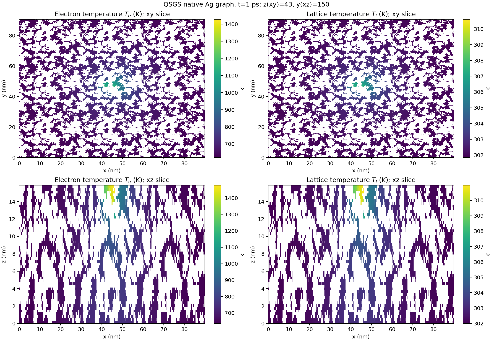
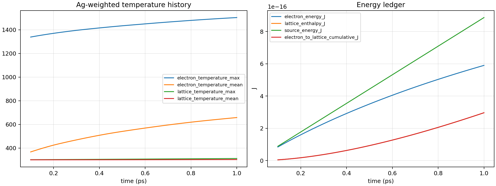
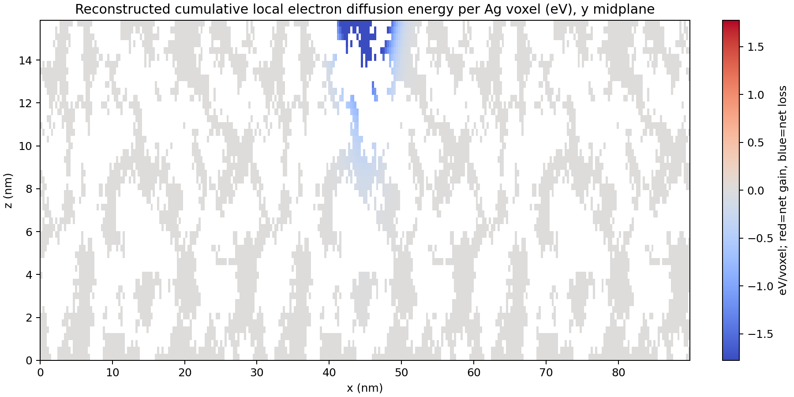

# TTM_1PS_PHYSICAL_AUDIT

日期：2026-10-29  
范围：只核查已完成的 Ag–Ti₃SiC₂ QSGS 双温（TTM）`I₀=5 eV/(ps·Å²)`、累计 1 ps 计算。此次没有重跑该算例，也没有检查或改动其他窗口的单温 1×/2×任务。

## 结论

现有数据**没有显示单位换算或总能量记账错误**。1 ps 输入电子系统的能量为 `8.8622×10⁻¹⁶ J`，约 `33.4%` 已传入晶格；按当前 Ag 晶格焓模型换算，晶格平均温升应约 `2.23 K`，与实测 `302.23 K` 一致。能量残差为源能量的 `2.16×10⁻¹⁴`。

晶格升温缓慢主要来自**有限的电子—晶格耦合时间尺度和很大的晶格热容量**。电子扩散则显著削弱热点局部性：它把电子能量从高斯源区送入更大的 Ag 网络，令 90 nm 周期域的大部分 Ag 都升温。两者同时发生；电子扩散既降低局部电子峰值，也使更多 Ag 体积参与电子—晶格能量交换。

1 ps 时没有 Ag 液相。当前 3×3 周期域和 z 绝热的边界 A 模型，尚不足以证明孤立的局部稳定熔池：电子扩散特征长度已与横向周期盒同量级或更大，且 Ti₃SiC₂ 只作为几何掩码，不储热、不导热。继续按旧 `I₀=5` 条件长时间供热会在封闭域内累积能量，不能据此可靠预测真实复合材料的局部熔池和凝固。

## 本次审计对应哪一个结构和算例？

1 ps 结果来自旧几何 `models/ag_ti3sic2_qsgs_1to1_finer/qsgs_morphology.npz`，不是后来出现的 `Ag=39.9586 vol%` 几何。旧几何 SHA-256 为 `7e0e1509b414597ce4e2a1c9fc387ed9656caf507f1186e2d28de79c3c1bfc43`，种子 20261024，原单胞 `100×100×50` 个约 3 Å 体素，Ag 体素占比 `41.6654%`。此次算例把该单胞在 x/y 方向各重复 3 次，得到 `300×300×50` 体素、约 `89.89×90.56×15.86 nm` 的计算域；x/y 周期，z 绝热。运行记录声明使用 3feb5bc 数值基线和连通 Ag 原生体素图，1 ps 汇总状态为完成。

| 几何 | Ag 体积分数 | 来源/本次用途 |
|---|---:|---|
| 旧 `qsgs_morphology.npz` | 41.6654% | 本报告唯一使用的 1 ps TTM 几何 |
| 后续 `nano_geometry_ag607wt_ti3sic2_393wt.npz` | 39.9586% | 本报告未用于任何温度或能量计算；仅用于区分数据版本 |

后续几何文件 SHA-256 为 `edebee1d8d254a60e51c7de0b63d96c10263020989c9c963449b932323e95695`。其 `composition_geometry.json` 说明该文件以 60.7 wt% Ag / 39.3 wt% Ti₃SiC₂ 及候选密度换算体积分数，并由已有 QSGS 生长秩场阈值化得到；它不是重新抽样的一份独立随机生长结构。旧几何的二值体积分数若用候选密度 10.49/4.52 g·cm⁻³换算，对应约 62.37 wt% Ag（Ag/Ti₃SiC₂ 质量比约 1.658），因此“1to1”目录名不能代替实际组成核对。当前 `I₀=64` TTM 续热任务也从旧 `qsgs_morphology.npz` 起算，但与本报告的旧 `I₀=5` 数据分开。

旧算例热源定义为横向 `exp(-r²/R²)`、从顶部向内 `exp(-d/l_skin)`，`R=30 Å`、`l_skin=20 Å`，`I₀=5 eV/(ps·Å²)`。单位换算得到峰值面通量 `8.0109×10¹³ W/m²`，峰值体热源 `4.0054×10²² W/m³`。对实际 Ag 掩码进行体素积分后，功率为 `8.86218×10⁻⁴ W`，故 1 ps 总输入为 `8.86218×10⁻¹⁶ J`。这不是把 Ag 掩码后的功率重新归一化回名义值。

## 温度与相态结果

表中均为 Ag 体积加权/体素统计。完整体场只在 1 ps 归档；0.1、0.2、0.5 ps 有历史标量样本，没有对应完整三维快照。

| 时间 (ps) | 电子均温 (K) | 电子最高温 (K) | 晶格均温 (K) | 晶格最高温 (K) | Ag 液相体积分数 |
|---:|---:|---:|---:|---:|---:|
| 0.1 | 366.91 | 1338.69 | 300.034 | 300.998 | 0 |
| 0.2 | 424.39 | 1370.18 | 300.132 | 302.064 | 0 |
| 0.5 | 540.40 | 1433.97 | 300.698 | 305.404 | 0 |
| 1.0 | 657.66 | 1503.52 | 302.230 | 311.279 | 0 |

1 ps 的 Ag 电子温度分布为：最小 `620.29 K`、中位数 `643.16 K`、q99 `809.54 K`、q99.9 `1037.66 K`、最大 `1503.52 K`。晶格温度分布为：最小 `301.84 K`、中位数 `302.07 K`、q99 `303.89 K`、q99.9 `306.38 K`、最大 `311.28 K`。最高晶格温度位置距热源中心横向约 `21.0 Å`、距上表面约 `11.1 Å`。

按“距热源中心横向不超过 30 Å，且距上表面深度不超过 20 Å”定义源区，里面有 734 个 Ag 体素；源区电子均温/最高温为 `1329.57/1503.52 K`，晶格均温/最高温为 `309.42/311.28 K`。电子高温区仍可见，但外围电子背景也已明显升温。以高于 `300 K + 50%×(峰值温升)` 定义时，电子高温 Ag 体积约占 Ag 的 `0.299%`，晶格高温 Ag 体积约占 `0.168%`。因此既不是“所有温度完全相同”，也不是能长期保持在仅数 Å 的源区内。

## 能量账本与 2.23 K 温升

| 1 ps 项目 | 数值 |
|---|---:|
| 累计外部热源输入 | `8.862179×10⁻¹⁶ J` |
| 电子系统剩余能量 | `5.898437×10⁻¹⁶ J` |
| 晶格焓增量 | `2.963742×10⁻¹⁶ J` |
| 电子→晶格累计交换 | `2.963742×10⁻¹⁶ J` |
| 全域电子扩散净能量 | 约 `1.15×10⁻²⁹ J` |
| 全域能量残差 | `−1.914×10⁻²⁹ J`（相对输入 `2.16×10⁻¹⁴`） |

在绝热 z 与周期 x/y 下，扩散只在域内搬运电子能量，全域净值应接近零；这不代表局部没有扩散。用每个 Ag 体素的最终电子能量、源项和累计耦合反推局部扩散后，半 L1 总变差约 `8.62×10⁻¹⁶ J`，说明有显著的空间再分配。由最终场梯度和 Ag 共享面重建的源区净向外功率约 `7.29×10⁻⁴ W`；它是 1 ps 末态的瞬时估算，不是保存的完整通量历史。

当前候选 Ag 晶格在 300 K 的 `Cp≈235.47 J/(kg·K)`，参考密度 `10490 kg/m³`，故体积热容约 `2.469×10⁶ J/(m³·K)`。全域 Ag 质量约 `5.643×10⁻¹⁹ kg`。即使把全部 1 ps 热源能量瞬时交给晶格，平均温升也只有约 `6.67 K`；实测晶格焓对应 `2.23 K`，恰为这个上限的约 `33.4%`。因此“1 ps 后只有 2.2 K”与当前热容及能量转移比例相符。

## 电子扩散、耦合时间与参数适用范围

候选表 `Ag_TTM_hybrid_figure_fit_300_20000K.csv` 范围为 `300–20,000 K`，每 100 K 一点。仓库 README 说明：`Ce` 与 `G` 来自 Lin 等文献图像数字化/拟合，`ke` 来自 Karna & Giri 等文献图像拟合；这是跨来源的候选组合，不是已验证的、彼此自洽的生产参数。1 ps 电子最高温度 `1504 K` 未越出该表范围，且求解器未启用低温外推。

在 Ag 平均电子温度 `657.66 K` 处插值：

- `Ce≈4.163×10⁴ J/(m³·K)`；
- `ke≈608.9 W/(m·K)`；
- `G≈2.5×10¹⁶ W/(m³·K)`；
- `αe=ke/Ce≈1.463×10⁻² m²/s`。

因此一侧特征扩散长度 `sqrt(αe t)` 约为 `38.2 nm`（0.1 ps）、`85.5 nm`（0.5 ps）、`120.9 nm`（1 ps）。在 300 K 表格端，`αe≈2.264×10⁻² m²/s`，相应长度约为 `47.6/106.4/150.5 nm`。该尺度是按均匀材料参数估算的特征长度，不是复杂 Ag 曲折网络里的精确热前沿；但它与 90 nm 横向周期盒相当或更大。加上周期边界，源区的周期镜像在较长时间会相互影响。

`Ce/G≈1.67 ps` 是电子热容量相对耦合的特征时间；晶格 `rho Cp/G≈98.8 ps` 表示在固定 1 K 电子—晶格温差下晶格响应较慢，不应误称为整个耦合系统的单一平衡时间。故 1 ps 内仅部分源能量进入晶格是合理的。

## 最小敏感性对照

未额外启动大型全域算例。下表是可复现脚本里的低成本约化对照，必须与全域结果区分：

| 对照 | 1 ps Ag 晶格均温 (K) | 晶格接收输入能量比例 | 说明 |
|---|---:|---:|---|
| 全域实算，原始 `G, ke` | 302.230 | 33.4% | 归档的 3D 原生 Ag 图结果 |
| 单体积均匀 0D，`G×0.5` | 301.249 | 18.7% | 同总功率、无空间梯度 |
| 单体积均匀 0D，`G×1` | 302.245 | 33.7% | 与全域平均温度非常接近 |
| 单体积均匀 0D，`G×2` | 303.647 | 54.7% | 同总功率、无空间梯度 |
| 独立体素极限，关电子扩散、`G×1` | 300.614 | 9.2% | 精确网格热源按 4096 个等计数源强箱分组；不是完整 3D 重跑 |

零电子扩散基准下，源区电子高温尾部比全域实算更尖锐（约化模型 q99.9 约 8354 K，而全域实算 q99.9 为 1038 K），但晶格平均升温更小，局部晶格 q99.9 约 419 K。它显示电子扩散会降低源区局部峰值、扩大受热 Ag 体积，并增加 1 ps 内总体电子—晶格交换；该极限只用于诊断空间扩散作用，不能作为真实材料预测。

保持 `Ce,G` 不变时，`ke` 倍率会使 `sqrt(αt)` 按其平方根缩放：

| `ke` 倍率 | `sqrt(αt)` @ 0.1 ps / 0.5 ps / 1 ps (nm) |
|---:|---:|
| 0.5 | 27.0 / 60.5 / 85.5 |
| 1 | 38.2 / 85.5 / 120.9 |
| 2 | 54.1 / 120.9 / 171.0 |

这是解析尺度敏感性，不是把整套 3D 求解器分别重跑 `ke×0.5/2`。这些敏感性支持“当前局域性强烈受电子输运控制”，但不支持任意降低 `ke` 来造出熔池。

## 对用户提出的六个问题逐项回答

1. **2.23 K 是否是单位、代码或能量记账错误？** 当前证据不支持。名义热源换算、Ag 掩码积分、电子/晶格能量、耦合项及能量残差彼此闭合；候选 Ag 热容也准确解释了该平均温升。不能据此宣称所有物理参数都已验证。
2. **电子—晶格耦合是否使晶格升温慢？** 是。1 ps 仅约三分之一输入能量进入晶格，`Ce/G≈1.67 ps`，同时 Ag 晶格体积热容远大于电子热容。候选 `G` 的 0D `0.5×/2×` 对照会明显改变平均晶格温度，故定量值仍依赖候选 `G`。
3. **电子扩散是否过快地分散局部热源？** 对当前模型和时间尺度，是。扩散长度超过高斯半径许多倍，并与横向盒子相当/更大；最终 Ag 电子温度最小值已约 620 K，说明热响应遍及计算域。局部电子热点仍存在，但被宽广背景升温包围。
4. **当前计算域/周期边界是否足以模拟孤立局部熔池？** 目前不能确认。约 90 nm 横向周期长度短于 1 ps 特征扩散长度，周期像会影响长时演化；z 向只有约 15.9 nm 且绝热。边界 A 又排除了骨架热容量和热导，因此不能用来定量预测真实复合材料冷却。
5. **电子物性来源和范围是否可靠？** 这是有文献来源的候选数字化/拟合数据，适用温度表为 300–20,000 K；`Ce/G/ke` 跨来源拼接，仍需独立验证。此次 `Te` 范围在表内，没有证据显示越界外推。
6. **继续加热能否预测局部熔化，还是会全域升温？** 该旧 `I₀=5` 结果 1 ps 内无液相。边界 A 没有外部热沉，持续注入最终会增加全域能量；周期电子扩散也使局部性变弱。因此现有结果不足以支持局部稳定熔池预测。需要先对适合的更大横向域/热边界及候选参数做验证，再评价局部熔化。不要用调低 `ke` 或任意改 `G` 替代验证。

## 当前另一项计算状态

本报告没有读取或改动单温任务。单独的 `I₀=64` TTM 续热任务从 300 K 冷态检查点启动，使用旧 41.6654 vol% Ag 几何。2026-10-29 07:06 UTC 检查时，其 0–0.05 ps 阶段仍在运行，完成阶段为零、有效检查点仍是初始 300 K；此状态只作任务区分，不作为本报告数据，也未被中断或修改。

## 可复现材料与限制

运行 `ttm_1ps_physical_audit/reproduce.sh` 可从随附的原始 1 ps 三维快照、汇总 JSON、逐段历史 JSON、仓库几何与物性表重建统计量、图片及约化敏感性结果。`source_data/` 中的字段和 JSON 是从原计算目录复制的原始文件；相关 SHA-256 在 `ttm_1ps_physical_audit/sensitivity_results.json` 和 `SHA256SUMS.txt` 中。运行不调用 MD/TTM 求解，不写入或覆盖原计算目录。

主要局限：1 ps 中间完整体场未保存，故温度图只有 1 ps；历史曲线使用归档标量样本。末态电子热流为按 Ag 共享面和最终温度场重建的瞬时估计，未保存瞬态通量历史。Ti₃SiC₂ 在边界 A 中不具备热容量、导热或界面传热；所得结果不能代替完整复合材料的冷却/凝固预测。局部 0D/无扩散敏感性结果是诊断模型，不是新的生产计算。

附带文件：

- `ttm_1ps_physical_audit/audit_metrics.json`：温度、热点、能量和输运统计。
- `ttm_1ps_physical_audit/sensitivity_results.json` / `.csv`：约化敏感性结果。
- `ttm_1ps_physical_audit/temperature_history_0p1_0p2_0p5_1ps.csv`：历史样本表。
- `ttm_1ps_physical_audit/analyze_existing_run.py`、`run_sensitivity.py`、`reproduce.sh`：复现脚本。
- `ttm_1ps_physical_audit/source_data/`：原始 1 ps 输出快照和 JSON。
