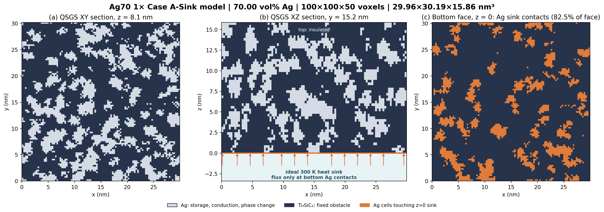

# Ag70 1× Case A-Sink model geometry

This figure shows two native QSGS sections and the actual Ag contact mask on the bottom `z=0` face. Ag voxels can store and conduct heat and undergo phase change. Ti₃SiC₂ voxels remain fixed geometric obstacles. The ideal 300 K sink couples only to Ag cells touching that face; the figure is a model schematic, not a simulation result.

Geometry: `100×100×50` voxels, `69.9996 vol%` Ag, physical dimensions `29.96×30.19×15.86 nm³`. In this geometry, Ag occupies `82.49%` of the bottom face. Geometry and production model provenance: `codex/single-temperature-study` at `e891d7717678d4e4c33119c0169693959eeb192f`.
