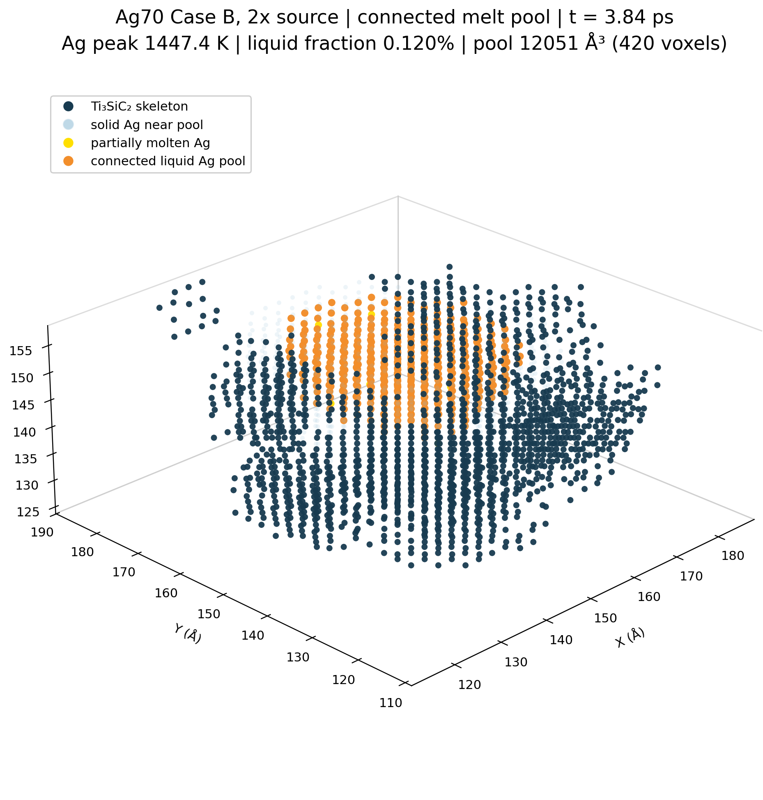

# Ag70 1× Case A-Sink model geometry

This figure shows two native QSGS sections and the actual Ag contact mask on the bottom `z=0` face. Ag voxels can store and conduct heat and undergo phase change. Ti₃SiC₂ voxels remain fixed geometric obstacles. The ideal 300 K sink couples only to Ag cells touching that face; the figure is a model schematic, not a simulation result.

Geometry: `100×100×50` voxels, `69.9996 vol%` Ag, physical dimensions `29.96×30.19×15.86 nm³`. In this geometry, Ag occupies `82.49%` of the bottom face. Geometry and production model provenance: `codex/single-temperature-study` at `e891d7717678d4e4c33119c0169693959eeb192f`.

## Ag70 Case B 2× reheating pool snapshot

This local 3D view is rendered from the full native `100×100×50` QSGS geometry at `t = 3.84 ps` in the 2× reheating run. The orange voxels are the largest connected liquid-Ag cluster (`12,051 ų`, 420 voxels); dark blue marks the nearby Ti₃SiC₂ skeleton, and pale blue marks nearby solid Ag. The crop is centered on the pool to make its spatial relation to the solid scaffold visible. The scaffold remains solid in this model and participates in heat storage and conduction.
