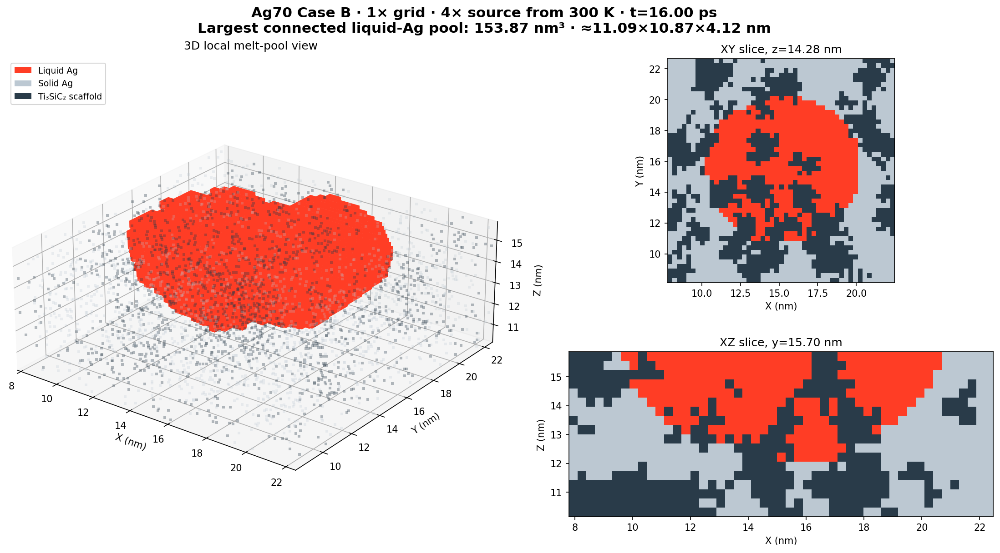

# Ag70 Case B, 1× grid, 4× source: heating and solidification

This run uses the Ag70 QSGS geometry on a 100 × 100 × 50 grid. The initial
temperature was 300 K. A 4× Ag-only Gaussian source (R = 50 Å, 20 Å absorption
depth, centered at 149.8175/150.9287 Å) supplied 6.205434 mW. Case B used a
300 K ideal sink on the bottom Ag contacts (8,249 voxels; 746.097859 nm²);
x/y boundaries are periodic and the remaining z boundary is insulated. The
calculation is a single-temperature enthalpy model, not MD or TTM.

The Ti₃SiC₂ property implementation permits queries through 2,000 K. Its
Barsoum-correlation values above their cited experimental range are
extrapolations. The scaffold peak reached 1,960.987 K. The Ag peak reached
2,011.229 K; the scaffold property ceiling applies to the scaffold, not Ag.

At 16.0 ps the source was switched off and the saved state entered cooling.
The cooling branch reached 16.252452 ps, when the Ag liquid fraction and
largest liquid cluster were both zero. The final energy-balance residual was
about −8.61 × 10⁻²⁵ J. The summary records the final temperatures, integrated
source and sink energies, geometry hash, and stop condition.

`heating_timeseries_4x_through_16p3ps_pre_cooling.csv` is the separate
continuous-heating trajectory, retained through 16.3 ps for comparison. It
continues heating beyond the 16.0 ps checkpoint used to start cooling; do not
concatenate it with `cooling_timeseries.csv` as though both files describe one
single path. Its maximum recorded connected liquid cluster is 153.875 nm³.
The 3D melt-pool image at the 16 ps heating checkpoint is stored alongside the
run and was already tracked in the repository before this data bundle.

## Key files

- `caseB_preflight.json`: numerical and property preflight. The short solver
  checks used 3× source; `fresh_run_source_validation` separately verifies
  4× initialization at exactly 300 K and 6.205434 mW.
- `caseB_run_summary.json`, `run_state.json`, `cooling_transition.json`, and
  `source_schedule_events.json`: run configuration and completion record.
- `heating_timeseries_4x_through_16p3ps_pre_cooling.csv`,
  `cooling_timeseries.csv`, and `liquid_clusters.csv`: temperatures, energy
  audit, phase fraction, and tracked connected liquid clusters.
- `checkpoints/initial_300K.npz`,
  `checkpoints/cooling_start_4x_from_16ps.npz`, and
  `checkpoints/cooling_solidification_complete.npz`: initial, heat-off, and
  final verified states. Each checkpoint stores the complete temperature,
  enthalpy, liquid-fraction, and cluster-tracking fields.
- `run_ag70_1x_caseB_4xsource_fresh300K.py`: runner used for this case.

The geometry is the tracked file
`../qsgs_morphology_ag70vol.npz`, SHA256
`03ef47b1dd534b3215cf03f42c8cf7e887dcdfcc185b33bab7453cd838c1faac`.
The property tables, provenance note, and generator are in
`../../../phase_field_qsgs/`. The solver and property implementation used
by the run are included in the same repository revision as this bundle. The
run metadata records base revision `5c079cd82b458f382a333a3c94c80b0de55fcf95`;
the solver and property files had local changes at that time and are captured
in this publication commit. `SHA256SUMS` covers the primary run artifacts,
geometry, solver, and material-property inputs.

To repeat the case without overwriting this result, copy the run directory to
a new sibling run directory, then execute `python run_ag70_1x_caseB_4xsource_fresh300K.py preflight`
and `python run_ag70_1x_caseB_4xsource_fresh300K.py run --source-multiplier 4`
from that copy. The runner requires NumPy and Numba; this run used Numba 0.68.1
with five threads. Preserve the 2000 K scaffold property guard and verify the
preflight before a long run.
