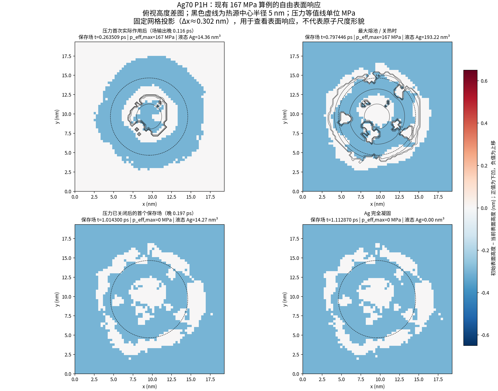

# P1H 电弧压力作用机制诊断

## 结论

对已有 0、1.8、16.7、167 MPa 四档结果完成了后处理；没有增加压力、修改物理模型或重跑长算例。结论是：**167 MPa 的压力确实以向下法向载荷进入外露 Ag/气界面，但这组计算没有形成可分辨的中心凹坑，也没有显示压力驱动 Ag 从中心向环带堆积。时间序列没有出现“先凹下、后恢复”的证据；中心高度指标全程不为正，最终仍轻微上凸。**

当前证据更支持“施加载荷后流体压力和表面产生了响应，但短时计算中的横向 Ag 迁移小、骨架/糊状区阻尼和约 0.302 nm 的固定网格限制了可见形貌变化”。这些因素不能由现有四档算例唯一拆分；尤其不能把骨架阻力单独认定为根因。

## 五项机制核查

| 核查项 | 现有数据回答 | 证据与边界 |
| --- | --- | --- |
| 压力实际分布 | 是，载荷进入计算并朝下 | 167 MPa 档在熔池峰值/关热帧的有效压力最大值为 166.805 MPa，压力合力为 −8.2103×10⁻⁹ N。共同帧独立积分与求解器力记录的相对差小于 6.1×10⁻⁸；37 个非零压力历史采样的合力方向均向下。载荷只覆盖外部、朝上、Ag 覆盖且液态的 VOF 界面，不包括未显式解析的骨架内部孔道界面。 |
| 压力与表面张力 | 当前离散载荷区内压力势明显大于曲率表面张力势 | 峰值帧中，按 `p_eff ≥ 0.1 p_eff,max` 筛出的 999 个界面单元，`p_eff` 中位数 83.841 MPa；`|γκ|` 中位数 0.247 MPa、90 分位 2.349 MPa，逐单元 `p_eff/|γκ|` 中位数约 306。液相加权表面张力中位数约 0.438 N/m。求解器水动力压力在同一单元集合中位数约 112.3 MPa（10–90 分位约 84.0–165.7 MPa），显示内部压力场有同量级响应。该比较是当前未校准、欠分辨模型的离散势场比较，不能据此宣称实际材料的精确力平衡。 |
| Ag 连续介质迁移 | 没有观察到可辨认的中心向周边净搬运 | 同一时刻 `t=0.504856 ps`，167 MPa 固定网格投影的 Ag 标记变化等效体积仅 0.01147 nm³（约初始 Ag 体积的 2.8×10⁻⁶）；中心变化 −0.00633 nm³、5–8 nm 环带变化 −0.000685 nm³，没有环带堆积信号。该投影不是保守质量统计；真正的全域 Ag 质量漂移由求解器历史记录，最大约 0.00151%。流速场非零（该共同帧液态 Ag 加权平均约 1.96 m/s，峰值约 35.9 m/s），但局部速度不等同于形成熔坑所需的净径向物质迁移。 |
| Ti₃SiC₂ 骨架阻力 | 阻尼存在，但其是否为主因尚不能单独判定 | 骨架固定；模型采用 `solid_drag_s=1×10¹¹ s⁻¹` 的探索性阻尼，液态 Ag 中位阻尼为零、99 分位可达约 8.5×10¹⁰ s⁻¹。共同帧液态 Ag 加权平均速度在骨架邻近/远离区域约 1.90/2.00 m/s，差异小且在峰值帧不保持同一趋势。因此可说骨架和糊状区阻尼可能限制部分通道，不能说现有证据已经证明它是唯一或主要原因；阻尼参数也未由实验校准。 |
| 加热到凝固的形貌历程 | 没有“凹陷形成后又恢复”的记录 | 167 MPa 算例 `source_center_depression_nm` 全程最大值为 0（初始基准），其余记录均为负；负值按本项目定义表示上移。全程最小值 −0.264 nm 出现在 0.162959 ps。关热帧为 −0.205 nm，完全凝固帧为 −0.216 nm；四个保存场中中心低于初始表面的网格列数均为 0。由此只能判定：本次输出中未形成网格可分辨的中心凹坑，不是已观察到的坑冷却后消失。 |

## 四个关键时刻

表面高度变化定义为“初始表面高度 − 当前表面高度”，正值表示下凹，负值表示上移。溶池体积采用求解器时间序列，不用固定网格投影分数求和替代。

| 时刻 | 压力与载荷 | 熔化/速度 | 中心 / 环带平均高度变化 | 判断 |
| --- | --- | --- | --- | --- |
| 首次有效压力 `0.147391 ps` | 历史记录有效压力峰值 57.221 MPa，`Fz=−1.0104×10⁻¹¹ N` | 液态 Ag 约 0.300 nm³，最大速度 0.779 m/s | 该时刻历史中心指标为 0 | 载荷开始作用时液相很少；没有同刻完整三维快照。最近完整场为 `0.263509 ps`（晚 0.116119 ps），该场液态 Ag 14.365 nm³，中心高度变化 −0.187 nm。 |
| 最大熔池 / 关热 `0.797446 ps` | 有效压力峰值 166.805 MPa，`Fz=−8.2103×10⁻⁹ N` | 总液态 Ag 193.225 nm³；最大连通簇 177.486 nm³；快照最大速度约 49.52 m/s，液态 Ag 加权平均约 2.06 m/s | 中心 −0.205 nm；5–8 nm 环带 −0.170 nm；中心下凹网格列数 0 | 压力最高、熔池最大时仍为上移，不是向下凹坑。 |
| 压力完全关断 `0.817446 ps` | 这是关热后 0.02 ps 平滑关压的设定终点 | 此时无完整保存场；历史中最后一个非零压力记录在 `0.817160 ps`，首次记录为零在 `0.836874 ps` | 最近完整压力为零的场在 `1.014300 ps`：中心 −0.213 nm、环带 −0.173 nm；液态 Ag 14.267 nm³ | 完整场晚于关压 0.196854 ps，且已进入后期冷却。此采样间隔限制了对关压瞬间形貌的细节判断，但未显示下凹。 |
| Ag 完全凝固 `1.112870 ps` | 有效压力为零 | 液态 Ag 为 0；全域 Ag 质量漂移约 −0.00151% | 中心 −0.216 nm；环带 −0.178 nm；中心下凹网格列数 0 | 最终中心仍轻微上移，没有永久熔坑。 |

图中展示 167 MPa 算例四个可用三维场快照的表面高度投影及压力等值线。它是固定网格诊断投影，不是原子尺度形貌。



## 压力档位对照

在共同场时刻 `0.504856397 ps`，压力合力、界面压力、Ag 标记和表面响应可直接比较：

| 压力峰值 | 重算 `Fz` | 中心相对零压变化 | 5–8 nm 环带相对零压变化 | Ag 标记变化等效体积 |
| ---: | ---: | ---: | ---: | ---: |
| 0 MPa | 0 | 0 | 0 | 0.01180 nm³ |
| 1.8 MPa | −6.3314×10⁻¹¹ N | 0 | −0.000674 nm | 0.01177 nm³ |
| 16.7 MPa | −5.8744×10⁻¹⁰ N | +0.000350 nm | −0.04155 nm | 0.01159 nm³ |
| 167 MPa | −5.8776×10⁻⁹ N | +0.01401 nm | −0.27446 nm | 0.01147 nm³ |

167 MPa 使中心相对无压力算例略微降低、外环相对升高，说明表面响应方向上有变化；但中心仍高于初始表面，且变化远小于一个网格步长 `Δx≈0.302 nm`。固定网格 Ag 标记投影在四档下变化相近，并且不是保守分区质量，不能将其解释成确定的 Ag 外流量。

所有压力组最大连通熔池约 177.49 nm³，四档差异不超过约 1.1%，且不随压力单调变化。完全凝固后四档中心高度指标都为负。现有数据因此支持“压力项有响应”，不支持“压力增加已形成熔坑”。

## 为什么 167 MPa 仍未形成熔坑

1. **载荷没有漏掉，但载荷也不自动等于坑形。** 外部压力势通过界面法向项施加，实际离散合力方向正确；它同时引起内部水动力压力调整。即使净法向载荷很大，形成可保留的坑仍需把中心 Ag 横向推到周边，并在凝固前保持这一重新分布。
2. **现有输出中看不到显著的径向 Ag 搬运。** 液态 Ag 有速度，但按相同时间的固定网格 Ag 标记没有出现可辨认的中心亏损—环带增益；全域 Ag 则按模型守恒。没有蒸发、喷出或质量损失时，凹坑只能靠这种横向搬运形成。
3. **骨架阻尼可能增加迁移阻力，但不足以单独定罪。** 骨架固定、糊状区有强阻尼；然而已保存的近/远骨架速度差并不一致，且阻尼取值为探索性输入。要区分主因，需要同一熔融检查点的受控短时压力开/关机械响应，而不能仅凭本组曲线归因。
4. **变形低于当前空间分辨率。** 网格间距约 0.302 nm，压力下中心相对零压的差异约 0.014 nm；关热和凝固时的表面指标幅度也小于一个网格步长。其尺度不足以支持定量坑深结论。
5. **压力不作用于模型未表示的内部孔道自由表面。** 因而这组结果测试的是上方外露界面受压，不能代表电弧压力对整个多孔熔池和所有 Ag/Ti₃SiC₂ 界面的作用。

因此，现有结果不能证明“真实材料在 167 MPa 下不会形成熔坑”，也不能证明压力值是实际纳米电弧载荷。它只表明在当前探索性连续介质模型、当前界面表示、阻尼、网格和小于 1.2 ps 的总历程下，没有观察到可解析的永久熔坑。

## 四时刻场文件与可复现性

每个主快照同时保存 VOF/界面、Ag 与骨架占据、液相分数、温度/焓、三分量速度、水动力压力、曲率、表面张力候选值、Marangoni 加速度、阻尼和材料 ID；压力 sidecar 保存原始压力、界面掩膜、有效界面压力和法向总应力势。字段定义见 [`P1H_FIELD_OUTPUT_SCHEMA.md`](../../P1H_FIELD_OUTPUT_SCHEMA.md)。

| 事件 | 主场文件（云工作区） | 压力场文件（云工作区） |
| --- | --- | --- |
| 首次有效压力后的最近场 `0.263509 ps` | `/workspace/p1h_arc_pressure_exploration_20261105/pressure_sensitivity_pi1/marangoni_on_gaussian_167MPa/p1h_marangoni_on_regular_t000.263509_ps.bin.gz` | `/workspace/p1h_arc_pressure_exploration_20261105/pressure_sensitivity_pi1/marangoni_on_gaussian_167MPa/p1h_pressure_marangoni_on_regular_t000.263509_ps.bin.gz` |
| 最大熔池 / 关热 `0.797446 ps` | `/workspace/p1h_arc_pressure_exploration_20261105/pressure_sensitivity_pi1/marangoni_on_gaussian_167MPa/p1h_marangoni_on_heat_off_t000.797446_ps.bin.gz` | `/workspace/p1h_arc_pressure_exploration_20261105/pressure_sensitivity_pi1/marangoni_on_gaussian_167MPa/p1h_pressure_marangoni_on_heat_off_t000.797446_ps.bin.gz` |
| 关压后首个完整场 `1.014300 ps` | `/workspace/p1h_arc_pressure_exploration_20261105/pressure_sensitivity_pi1/marangoni_on_gaussian_167MPa/p1h_marangoni_on_regular_t001.014300_ps.bin.gz` | `/workspace/p1h_arc_pressure_exploration_20261105/pressure_sensitivity_pi1/marangoni_on_gaussian_167MPa/p1h_pressure_marangoni_on_regular_t001.014300_ps.bin.gz` |
| 完全凝固 `1.112870 ps` | `/workspace/p1h_arc_pressure_exploration_20261105/pressure_sensitivity_pi1/marangoni_on_gaussian_167MPa/p1h_marangoni_on_solidified_t001.112870_ps.bin.gz` | `/workspace/p1h_arc_pressure_exploration_20261105/pressure_sensitivity_pi1/marangoni_on_gaussian_167MPa/p1h_pressure_marangoni_on_solidified_t001.112870_ps.bin.gz` |

完整场保留在当前云工作区，未把约 32 MB 的原始 float32 压缩快照重复复制进 Git。仓库已保存摘要、事件时间、场文件名、重新分析脚本和可视化图；文件清单见 [`arc_pressure_field_manifest.json`](arc_pressure_field_manifest.json)。

重新生成事件 CSV 和图（只读已有快照，不执行求解）：

```bash
python models/ag_ti3sic2_qsgs_1to1_finer/runs/single_temperature_mesh2_validation_20261027/liquid_ag_flow_p1h_arc_pressure_20261105/p1h_mechanism_event_diagnostics.py \
  --run-root /workspace/p1h_arc_pressure_exploration_20261105 \
  --output models/ag_ti3sic2_qsgs_1to1_finer/runs/single_temperature_mesh2_validation_20261027/liquid_ag_flow_p1h_arc_pressure_20261105/results/arc_pressure_exploration_20261105/p1h_mechanism_event_diagnostics.csv

python models/ag_ti3sic2_qsgs_1to1_finer/runs/single_temperature_mesh2_validation_20261027/liquid_ag_flow_p1h_arc_pressure_20261105/plot_p1h_pressure_event_surfaces.py \
  --run-root /workspace/p1h_arc_pressure_exploration_20261105 \
  --output models/ag_ti3sic2_qsgs_1to1_finer/runs/single_temperature_mesh2_validation_20261027/liquid_ag_flow_p1h_arc_pressure_20261105/results/arc_pressure_exploration_20261105/p1h_pressure_event_surface_maps.png
```

## 交付文件

- `p1h_mechanism_event_diagnostics.csv`：四事件时间对齐、场统计、压力/曲率/表面张力、Ag 标记投影和速度/阻尼指标。
- `p1h_pressure_event_surface_maps.png`：四个关键时刻的表面高度响应图和压力等值线。
- `p1h_mechanism_event_diagnostics.py`、`plot_p1h_pressure_event_surfaces.py`：只读后处理脚本。
- `P1H_PRESSURE_LOAD_RESPONSE_AUDIT.md`、`p1h_pressure_load_response_audit.csv`：四档载荷积分和共同时间对照复核。
