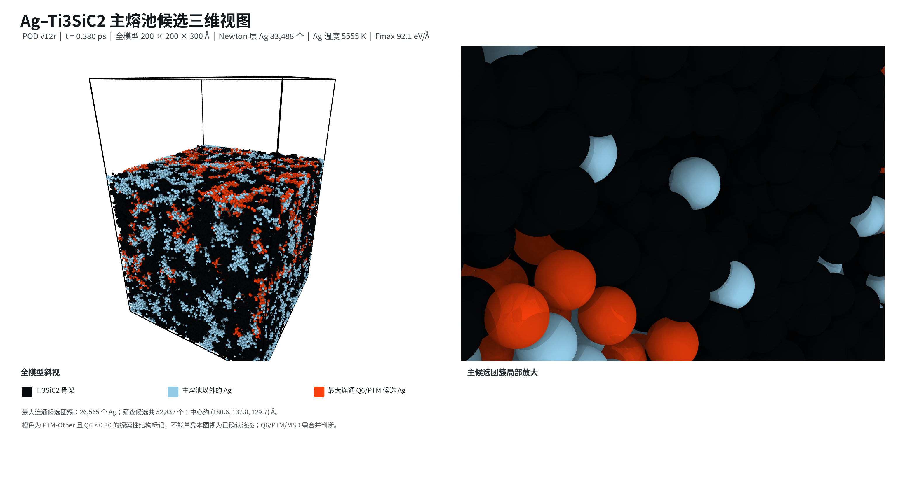

# Round7 POD v12r 主熔池候选图

- 快照：0.380 ps；全模型 200 × 200 × 300 Å，共 458,248 个原子。
- 牛顿层 Ag：83,488 个；平均温度约 5,554.97 K。
- 最大连通候选团簇：26,565 个 Ag；筛查候选共 52,837 个。
- 探索性筛查规则：牛顿层 Ag 中 PTM 为 Other 且 Q6 < 0.30；按 3.5 Å 邻接距离并考虑 x/y 周期边界识别连通团簇。
- 全模型最大原子力：92.08 eV/Å。

橙色仅表示结构筛查候选，不能单凭本图确认液态；需结合连续帧、PTM/Q6 与 MSD 判断。此归档包含图片和图注，不包含原始原子 dump 或运行日志。
