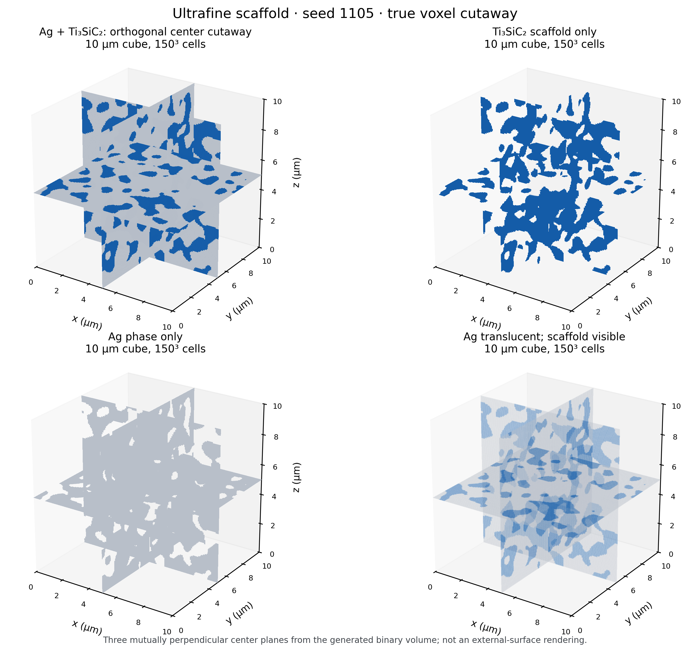

# Ag/Ti₃SiC₂ 超细—微米骨架 RVE

本目录建立了两套 150³、70 vol% Ag / 30 vol% Ti₃SiC₂ 的三维双相体素几何，用于后续局部传热和熔化凝固研究。两套RVE使用同一组三个QSGS随机几何，只改变物理尺度：超细骨架目标500 nm、10 μm立方体；微米骨架目标10 μm、200 μm立方体。尺寸是探索性设计值，不是从论文SEM图像量出的实测数据。

几何已生成并审计，投影格式和原生几何格式都通过了无热源单步兼容性检查。按用户后续指示，另对一个代表种子运行了两种尺度各10步的短程局部加热冒烟测试。完整加热、网格收敛、流动和真实电弧边界仍未验证。

## 结果速览

| 项目 | 超细骨架 | 微米骨架 |
| --- | ---: | ---: |
| 外部尺寸 | 10 μm × 10 μm × 10 μm | 200 μm × 200 μm × 200 μm |
| 网格 | 150³ | 150³ |
| 网格间距 | 66.667 nm | 1.333 μm |
| Ag / Ti₃SiC₂ | 70 / 30 vol% | 70 / 30 vol% |
| 骨架球心加权P50直径 | 0.533–0.550 μm | 10.667–10.995 μm |
| 三维主连通分量 | 两相均≥99.54%，且XYZ贯通 | 两相均≥99.54%，且XYZ贯通 |
| 内部界面面积密度 | 2.102–2.167 × 10⁶ m²/m³ | 1.051–1.083 × 10⁵ m²/m³ |

“直径”按三维欧氏距离变换的局部极大值中心计算最大内接球直径，按球心等权统计；它不是按相体素加权的严格局部厚度分布。主骨架中最小球直径为2个体素，因此网格还没有充分解析最细骨架细节。详见[几何验证报告](GEOMETRY_VALIDATION.md)。

## 代表几何图




图中三维视图是实际二值体数据的三个互相垂直中心切面，不是封闭外表面渲染。全部PNG为300 dpi，并使用Ag银灰色、Ti₃SiC₂蓝色。

## 目录

- `ultrafine_500nm/`、`micro_10um/`：每个尺度3个种子的FVM NPZ、原生几何NPZ、VTI及哈希元数据。
- `geometry_generation/`：可复现QSGS生成脚本、随机种子几何及所依据的仓库文件摘录。
- `geometry_audit/`：三维连通、内接球直径、弦长、界面密度和外表面暴露统计。
- `fvm_inputs/`：NPZ/VTI导出程序。
- `figures/`：10张300 dpi结果图和生成脚本。
- `validation/`：小网格/150³种子筛查、几何工具单元测试、两种求解器无热源检查和短程加热冒烟记录。
- `SOURCE_MANIFEST.json`：来源分支、提交、Git blob ID、SHA-256及输入接口说明。

## 复现命令

在 `/workspace/-` 仓库根目录执行：

```bash
cd /workspace/-/models/ag_ti3sic2_qsgs_ultrafine_micro_fvm
export OPENBLAS_NUM_THREADS=1
export MPLCONFIGDIR=/tmp/mplconfig
export XDG_CACHE_HOME=/tmp/.cache
python -m unittest discover -s validation -p 'test_geometry_tools.py' -v
python validation/screen_small_grid_seed_pool.py
python geometry_generation/screen_150_seeds.py
python geometry_generation/generate_qsgs_pair.py
python geometry_audit/audit_geometries.py
python fvm_inputs/export_fvm_inputs.py
python validation/validate_fvm_inputs.py
python validation/validate_native_fvm_inputs.py
python figures/render_figures.py
```

短程加热冒烟测试是单独命令，默认设置见 `validation/run_short_heating_smoke.py`。正式热源必须由宏观模型或实验给出，不能把该冒烟参数当成真实电弧工况。

## 判断

- **几何生成：GO（探索性RVE）**：体积分数、150³主连通和双向尺度映射满足本轮筛选目标。
- **最细颈部解析：NO-GO（定量流动/局部应力用途）**：主骨架出现2格最小内接球直径，需提高局部网格或根据SEM重建后再用。
- **FVM输入：GO（读入、单位、零热源恒温步与短程受热冒烟测试）**：不等同于正式工况收敛。
- **完整加热/熔化/流动/凝固：NO-GO（本轮未验证）**：需要有来源的局部热边界、材料参数、网格收敛和时间步/能量收敛检查。

本分支为 `codex/ultrafine-micro-qsgs-20261127`。源分支没有被切换或覆盖。
