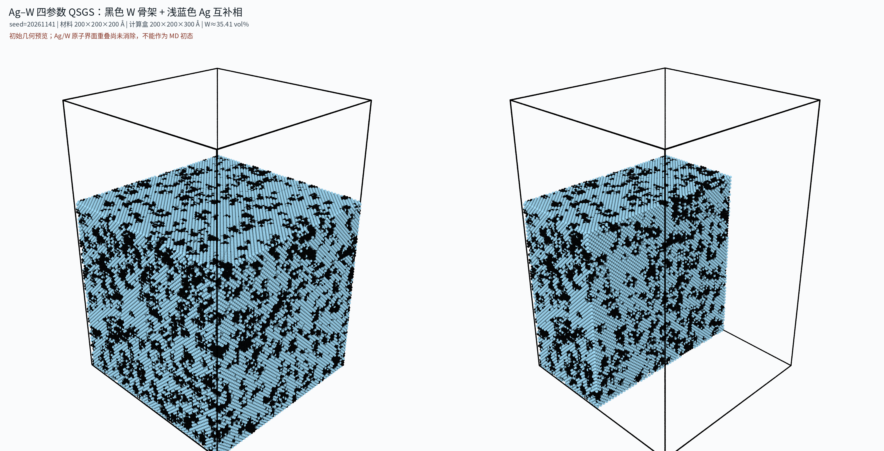

# Ag–W V15: four-parameter QSGS W skeleton

This is a new, additive model directory. It does not replace or modify V5–V14.

The W phase is generated first with the four-parameter stochastic QSGS rule; Ag occupies the complementary mask. The morphology is random and bicontinuous, not Gyroid. The rendering palette follows the user's reference: **black W skeleton** and **pale-blue Ag matrix**.

## Geometry preview



The material occupies `z = 0–200 Å`; the `200–300 Å` region is vacuum. The figure shows the initial, unheated morphology. It is not a melt-pool result.

## Build settings

| Setting | Value |
|---|---:|
| QSGS seed | 20261141 |
| Core seed probability | 0.005 |
| Growth probability base | 0.07 |
| Maximum growth generations | 12 |
| Target W-mask volume fraction | 0.35411 |
| Actual W-mask / Ag-complement fractions | 35.410995% / 64.589005% |
| QSGS grid | 120 × 120 × 120 (1.667 Å voxels) |
| Material / simulation box | 200 × 200 × 200 Å / 200 × 200 × 300 Å |
| Boundary conditions | `p p f` |

The mask fraction is set near the equal-mass Ag:W target. The generated lattice model contains 178,527 W and 304,151 Ag atoms (482,678 total); calculated Ag/W mass ratio is 0.9996288, a relative error of 0.0371% from 1:1.

## Current status and limitation

**Geometry/topology candidate only; not an MD-ready structure.** Both phases span z and have x/y winding rank 2; the largest-component shares are 98.20% for W and 99.91% for Ag. However, the independently sampled BCC-W and FCC-Ag lattices still overlap at the interface: the minimum initial Ag–W separation is 0.08 Å. Do not start MD or TTM from this file until interface reconstruction and a force/stability check have been completed.

The saved atom coordinates are the geometry-builder output, not a relaxed or heated configuration. The screenshot's orange melt pool has not been generated in V15; it must come from a later trajectory after a valid cold starting structure and heat-source run exist.

## Files

- `atomic_candidate/ag_w_qsgs.data.gz`: LAMMPS atomic-style data, W type 1 and Ag type 2.
- `atomic_candidate/ag_w_qsgs.extxyz.gz`: OVITO/ASE-friendly geometry.
- `atomic_candidate/qsgs_morphology.npz`: `W_backbone` and complementary `Ag_matrix` masks.
- `atomic_candidate/geometry_report.json`: parameters, atom counts, mass ratio, topology, and geometry-only status.
- `render_v15_qsgs_model_ovito.py`: reproducible black/blue full-box and cutaway render.
- `V15_QSGS_model_preview_CN.png`: combined preview.

Build command (from the repository root):

```bash
python research/ag_w_reference_pack/scripts/build_ag_w_qsgs.py \
  --output research/ag_w_reference_pack/models/ag_w_qsgs_200A/interface_reconstruction_v15_qsgs_w_skeleton_20261126/atomic_candidate \
  --seed 20261141 --p-core 0.005 --p-grow 0.07 --generations 12 \
  --target-w-fraction 0.35411 --grid 120
```

The shared generator refuses to overwrite existing output files. OVITO rendering also requires a working Vulkan driver; in this cloud environment the available Mesa lavapipe ICD was selected through `VK_ICD_FILENAMES` and `LD_LIBRARY_PATH`.
