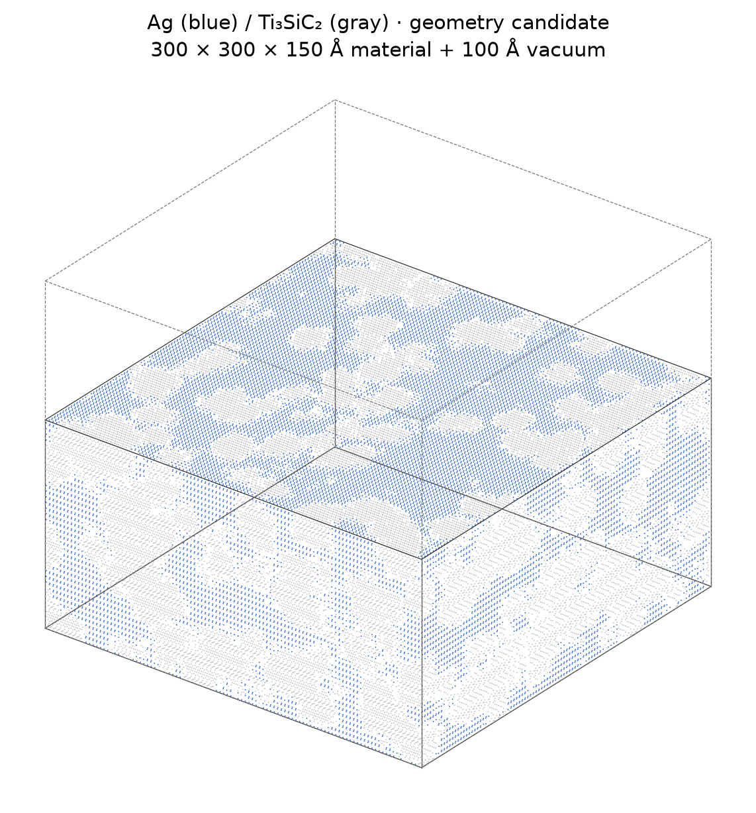
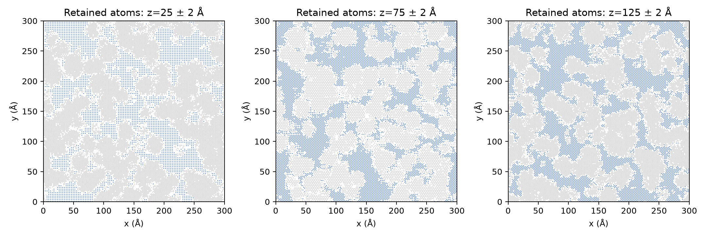
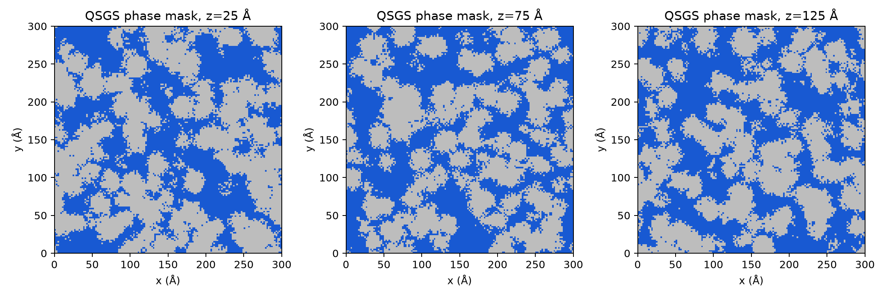

> **当前版本：[蓝色细骨架 / 灰色银（thinner_v2）](thinner_v2/README.md)**。下文为上一版历史预览，配色与当前要求相反。

# Ag–Ti₃SiC₂ 三维双连续结构预览

本次上传为用户要求的生成图片及对应几何审计。仅完成几何建模，未运行 calibration-v0 初始力、弛豫、平衡或 TTM 加热。

- 材料尺寸：300×300×150 Å；上方真空100 Å，总盒子300×300×250 Å。
- 原子数：861,266；Ag质量分数60.08477 wt.%、骨架相39.91523 wt.%。
- 灰色：Ti₃SiC₂母晶切割形成的骨架；蓝色：Ag。骨架整体Ti:Si:C=3.02186:1:1.98741，界面裁切导致小幅化学计量偏差。
- x/y周期、z非周期。固定层0–5 Å、恒温层5–15 Å、牛顿层15–150 Å。
- 两相各自为单一连通分量，x/y周期绕行及上下表面贯通检查通过；最小异相原子间距约2.200 Å。
- 本次使用新选定参数的QSGS风格随机生长。参数见generation_parameters.json，非历史交接恢复参数。

## 三维视图

实际保留原子的可见外表面；虚线框包括上方100 Å真空。

## 实际原子切片

z=25、75、125 Å附近各±2 Å的保留原子。白色表示该薄片内没有原子，含界面排除空间。

## 随机生长相区切片

这是原始QSGS划相网格，未扣除界面位点排除及孤立碎片，不等于最终原子占据图。

详细检查见[几何审计](GEOMETRY_AUDIT.json)与[导出验证](EXPORT_VALIDATION.json)。连通性取决于近邻阈值，几何通过不代表势函数或热稳定性验证。此目录未上传大型原子坐标文件，仅上传图片和审计元数据。
