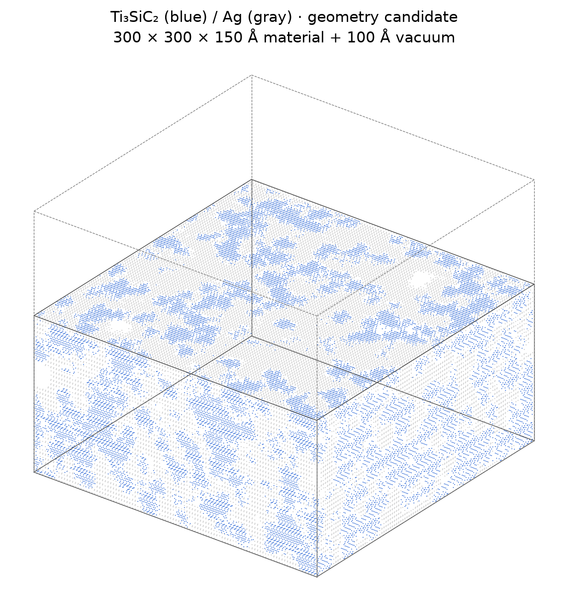
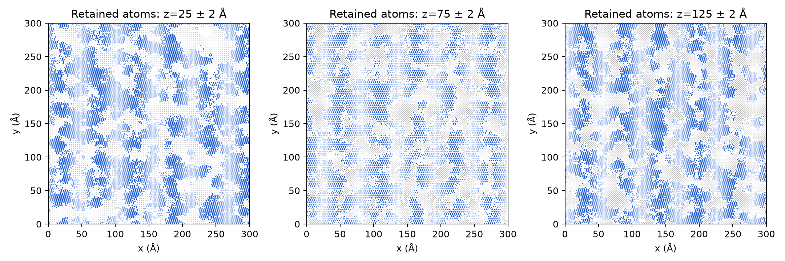
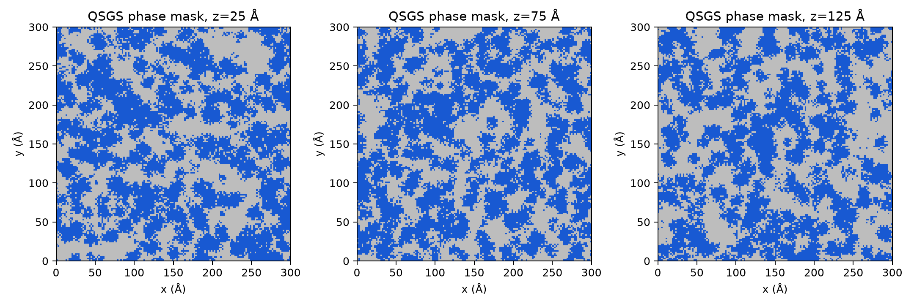
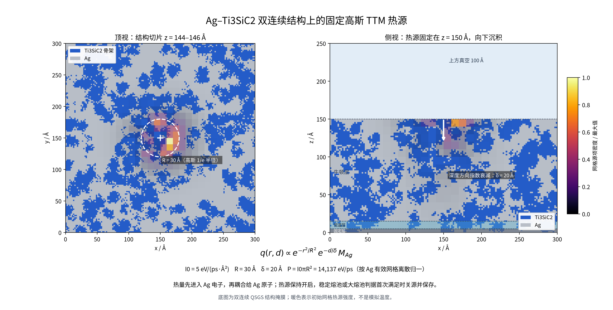

# 蓝色细骨架 / 灰色银：更新候选

蓝色=Ti₃SiC₂骨架，灰色=Ag。使用更高随机核心密度重新生成，不只是改变配色。

- 材料300×300×150 Å，真空100 Å，总盒高250 Å；x/y周期、z非周期。
- 总原子数804,175；Ag实际59.99514 wt.%、骨架相40.00486 wt.%。
- 固定层0–5 Å，恒温层5–15 Å，牛顿层15–150 Å。
- 两相各自单一连通分量；x/y周期绕行，且延伸至材料底部与顶部。界面最小距离≥2.20 Å。
- 随机核心概率由0.0005改为0.0015，生长概率与方向权重保持不变；按清理后的实际原子质量补偿比例。
- 网格形貌长度指标4V/S相对上一版下降约31%，仅为相区尺度比较，不是最小韧带厚度或力学稳定性指标。
- 骨架来自Ti₃SiC₂母晶，界面裁切后实际化学计量比详见GEOMETRY_AUDIT.json；未宣称严格整数化学计量。

MODEL_3D为实际保留原子的外表面视图；ATOM_SLICES为实际薄切片；PHASE_SLICES为去除界面重叠和孤立碎片前的划相网格，不能直接当成最终原子占据图。

生成参数、几何审计、导出验证和形貌尺度比较随图片保存。仅几何候选，尚未做calibration-v0初始力、弛豫、平衡或TTM加热。大型OVITO与LAMMPS结构保存在当前工作区geometry_thinner/，此仓库预览目录未上传大型坐标文件。

## 固定高斯 TTM 热源预览

- 固定在顶部中心 `(x,y,z)=(150,150,150) Å`，向材料内部 `-z` 方向沉积。
- 横向采用空间高斯 `exp(-r²/R²)`，`R=30 Å` 为强度降至中心 `1/e` 的半径；深度按 `exp(-d/δ)/δ` 衰减，`δ=20 Å`。
- 峰值吸收强度 `I0=5 eV/(ps·Å²)`；连续总功率 `I0πR²=14137.16694 eV/ps`，离散网格按 Ag 原子占比加权后归一到该值。无 Ag 的纯骨架格和空格源项为零。
- 使用 `30×30×25`、10 Å 网格；电子温度初值为 Ag 占据格 300 K，其余格为 0。TTM 只耦合 Ag 原子。
- 按用户要求，热源保持开启，稳定熔池或大熔池判据首次满足时关源并保存。
- 图中的暖色是初始网格热源强度，不是模拟温度；图使用已验收双连续形貌掩膜。**正式复合模型 TTM 加热尚未启动**，还要通过完整模型的无源耦合验收。

随图保存的 `gaussian_source_grid_5eV_R30_delta20.dat` 为体积源密度输入，单位 `eV/(ps·Å³)`；`Ag_Te300_grid_initial.dat` 为初始电子温度网格；详细积分、掩膜计数和输入结构哈希见 `GAUSSIAN_SOURCE_GRID_AUDIT.json`。
