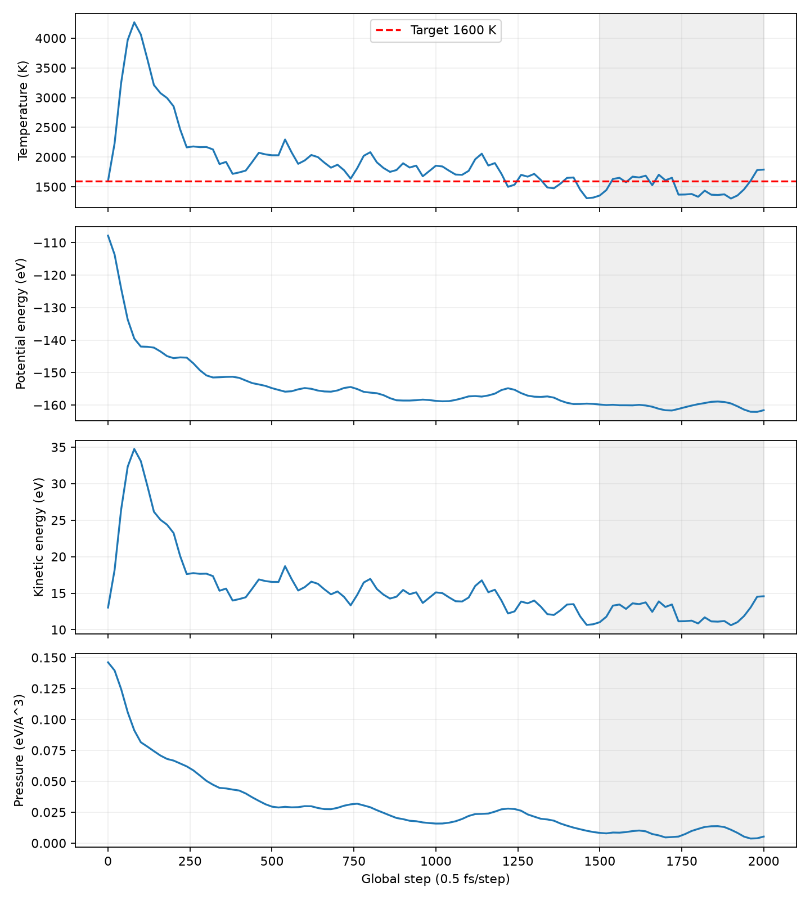
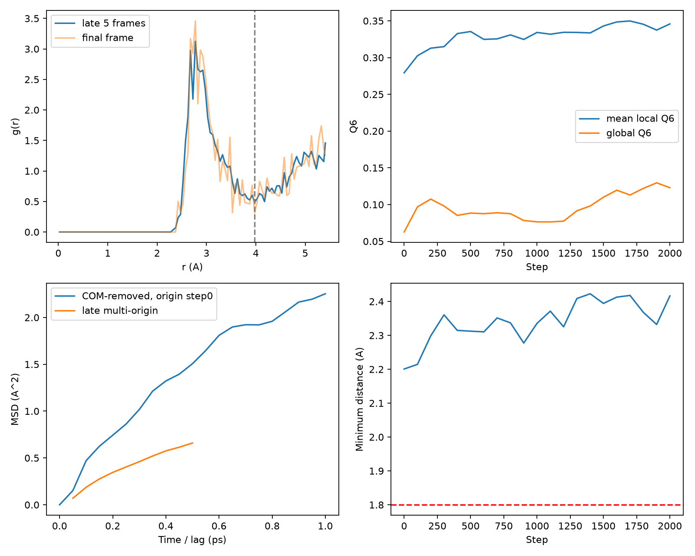

# D Ag64 step2000 离线液态候选审核

审核日期：2026-10-11（北京时间）。任务：`C-D-AGL-1250K-rho097-seed01`。

**LIQUID_CANDIDATE_STATUS=NO。** 已观察到密集短程配位、无序结构和原子迁移，但现有1 ps暖机不足以证明热平衡或稳定液态，也尚未进入原计划的1250 K候选取样阶段。这里的 NO 表示不满足候选冻结条件，不等于证明结构是固体。未生成 `C-D-AGL-1250K-rho097-seed01_liquid_candidate`，未改角色或升级为DFT/训练标签。

## 来源与拼接核验

D step2000 提交 `bc3ff0631db3b7d78dcc17556befa98c2f454480` 中的归档 SHA 为 `c3a88a759e0bd258e74632aba0a68e4f1a765fcbe8324034d5bf127b5aa69965`；`state.json` SHA 为用户提供的 `5d03864f07a98f177c3c0cbdcb850158ed89a64fa2a6ab7f879e8c7ab003be2a`。外层、MANIFEST、SHA256SUMS以及全部内部文件校验通过。执行身份对应上一段C签署配置与固定Ag势SHA；step2000坐标与checkpoint一致。

**step2000归档并不单独包含全程数据**：其热日志为step1020–2000的50行，轨迹为step1000–2000的11帧。本审查读取D原step1000提交 `145ee8050cf95a3a1988e868c6b935e10538f723` 的原始归档（SHA `b62a818e58a2cf423e4cb1b9ed0468ae73ad578a75c4b2cb9fb3f28baf75e7b1`），逐成员核验，并拼接51行原热日志和11帧原轨迹。step1000重叠坐标逐元素一致，去掉重复帧后，共101行日志、21帧，覆盖step0–2000、0–1 ps。原子ID、64 Ag组成、晶胞和PBC一致。

原始父族 `PF-AGL-1250K-rho097-seed01`；原数据角色 `liquid_pilot_candidate_not_training_or_independent_test`。初态是PCG64周期随机装填，并非晶态Ag熔化轨迹。盒边长10.826824658074 Å，密度9.03273341876 g/cm³，固定体积，原势SHA `958f4623e70b51c05e26e9b980f3c85bb1ac9852f3f260c8f75c6181e0c58447`。没有重新读取势参数或评估能量、力。

## A. 热稳定性

全程日志和曲线见 [thermal_full.csv](thermal_full.csv)、[thermal_full.png](thermal_full.png)。最后500步定义为 `1500 < step <= 2000`，对应0.75–1 ps、25个10 fs间隔日志点；不把step1500重复计入相邻窗口。

| 指标 | 前500步窗口：1020–1500 | 最后500步窗口：1520–2000 |
|---|---:|---:|
| 平均温度 / K | 1651.72 | 1523.94 |
| 温度样本标准差 / K（ddof=1） | 194.54 | 154.08 |
| 温度范围 / K | 1308.42–2057.27 | 1303.43–1789.78 |
| 温度描述性OLS斜率 / K每100 fs | −203.46 | −46.28 |
| 平均动能 / eV（全体系） | 13.45057 | 12.41001 |
| 动能描述性OLS斜率 / eV每100 fs | −1.65682 | −0.37689 |
| 平均势能 / eV（全体系） | −157.79005 | −160.41325 |
| 势能描述性OLS斜率 / eV每100 fs | −0.84207 | −0.30594 |
| 平均压力 / eV Å⁻³ | 0.01917425 | 0.00843070 |

`sampler_energy_eV` 是执行器记录的 `Atoms.get_potential_energy()` 势能，**不是总能**。续算日志单独记录动能；原step0–1000日志未保存动能列，本审查用原日志T、ASE kB与189自由度推导 `K=(189/2)kB T`，在CSV以 `kinetic_energy_source` 明确标注。189自由度经原轨迹的FixCom约束检查确认。没有补算势函数能量。总能仅可由势能与动能相加，Langevin热浴下不要求其守恒。

全程温度峰值仍为初始step80的4266.30 K。末窗口均温比1600 K目标低76.06 K，标准差154.08 K，与64原子去COM后正则瞬时涨落量级 `1600√(2/189)=164.6 K` 相近；不能凭单帧温度或该均值差断言热化失败。

但热平衡也尚不能确认：最后窗口温度描述性积分自相关时间约19.43 fs，有效样本数约6.43；前窗口约4.35。此短序列估计不稳定，不作为置信区间或严格显著性检验。既有C判据要求每窗口至少10个有效样本，且长度至少20τ，当前未满足。势能窗口均值继续下降2.6232 eV（约0.0410 eV/atom），压力也变化；这些迹象需更长的获批稳定区间审查。上述OLS斜率不附带未经自相关修正的显著性结论。固定体积NVT不要求压力恰为零。

结论：早期 `INITIAL_TRANSIENT` 已明显减弱；当前 `THERMALIZATION_NOT_ESTABLISHED`。有限日志未见NaN/Inf或明显能量爆炸，不能将尚未热化直接归为数值失稳。

## B. 结构分析

见 [structure_dynamics.png](structure_dynamics.png)、[rdf.csv](rdf.csv)、[frame_metrics.csv](frame_metrics.csv) 及 [final_atom_structure_metrics.csv](final_atom_structure_metrics.csv)。

末500步的5个已保存帧（1600、1700、1800、1900、2000）平均RDF：首峰约 **2.775 Å**，首谷约 **3.975 Å**。采用0.05 Å径向分箱；首峰与首谷从Gaussian σ=1 bin平滑曲线定位，未平滑g(r)同时保存。球壳统计仅延伸至半盒长5.4134 Å，避免超出完整球壳的几何范围。归一化为有序异原子对计数除以 `帧数×N×(N/V)×球壳体积`；有限N理想气体基线为(N−1)/N。首谷截断下平均配位数 **12.856**，末帧 **12.781**。单个64原子盒与5个相关帧的峰谷位置只是初筛值，未给出伪精确的独立采样误差条。

末帧原始Steinhardt局部Q6均值 **0.34579**、样本标准差 **0.07301**；全键平均全局Q6 **0.12293**。局部Q6不是Lechner–Dellago平均Q6。局部与全局Q6在松弛中有所增加，不能仅因数值低于理想FCC就断言液态成立。

使用第一谷截断的**常规固定截断CNA**：末帧FCC=0、HCP=0、icosahedral=0、OTHER_UNCLASSIFIED=64。算法按周期像中心局部坐标构建共同邻居键图，已用理想FCC/HCP静态几何核验：分别100%正确分类，Q6分别0.57452426/0.48476169。它不是自适应CNA。截断3.675–4.125 Å的敏感性检查仍未识别FCC/HCP，配位数变化11.19–13.84、局部Q6均值变化0.316–0.381，见 [cutoff_sensitivity.csv](cutoff_sensitivity.csv)。

**PTM未执行**：当前环境没有OVITO/PTM后端。没有伪造PTM分类，也未评估BCC所需第二壳层CNA。OTHER只能表示该固定截断方法未匹配所测模板；热畸变、不同局部有序、非理想晶体也可能归入OTHER，不等于液态标签。

结构判断：现有帧呈密集短程无序配位，未显示占主导的可识别FCC/HCP有序；尚不能据此断言形成了稳定液态。初态本来是随机装填，因此也不能把“失去晶序”当作已完成熔化的证据。半盒长范围的RDF不能建立或排除宏观长程晶序。

## C. 动力学与迁移

见 [msd.csv](msd.csv)、[msd_late_multi_origin.csv](msd_late_multi_origin.csv)、[atom_migration.csv](atom_migration.csv)。按固定原子ID、50 fs保存间隔逐帧minimum-image位移重建连续坐标，并扣除COM位移。相邻保存帧的最大MIC位移0.82750 Å，远低于半盒长，但稀疏输出仍不能严格排除两帧之间未记录的绕盒运动。

以step0为原点，step2000的COM扣除MSD为 **2.25322 Ų**；净迁移中位数 **1.36972 Å**。64原子中49个净位移>1 Å，8个>2 Å。step1000–2000相对原点step0的MSD描述性斜率约 **1.33723 Ų/ps**。另保存step≥1000的多时间原点MSD，但最长0.5 ps滞后只有一个时间原点，其余原点也高度相关。

**不报告扩散系数**：总轨迹仅1 ps，早期随机装填松弛贡献显著，末段热化未建立，也未验证稳定的长时线性扩散区间。不能直接把OLS斜率除以6作为Ag物性。原子迁移证据存在，不能独立区分热松弛、笼内运动与成熟液体扩散。

## D. 最近邻安全

21帧全程最小周期原子距离 **2.200686 Å**（初态）；末帧最小距离 **2.416451 Å**。已保存帧均未低于既有1.8 Å运行门槛，没有发现异常短距离。该结论仅覆盖保存帧，不能冒充2000个积分步骤逐步审核或短程DFT排斥验证。

## E. 冻结决定与缺少条件

`LIQUID_CANDIDATE_STATUS=NO`；`THERMALIZATION_NOT_ESTABLISHED`；`DFT=HOLD`。不输出或冻结液态候选结构，不改step2000 checkpoint、势文件、父族或数据角色。此审核没有签署任何新MD。

候选冻结仍缺：原计划1250 K冷却与平衡阶段的实际轨迹；足够长的热/势能/压力稳定区间与可靠自相关评估；可辨识扩散区间；足够的独立来源抽样及六候选间去重。PTM或自适应晶序检查可补充结构证据，但其单独通过也不解除这些缺口。剩余阶段必须另行授权，不能直接调用自动120000步continue。

本轮交付原创报告、已有日志的合并CSV、结构/迁移指标、图片、`metrics.json`、复现分析代码与`SHA256SUMS.txt`。没有新的MD、DFT或MACE训练，没有势函数能量/力计算，没有上传势文件或论文。

