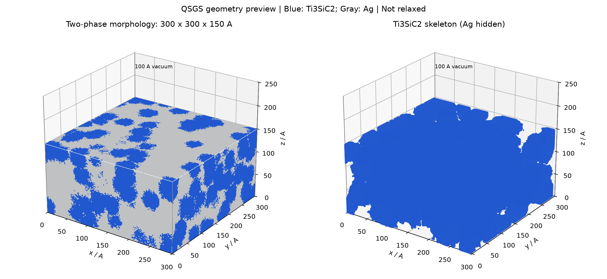
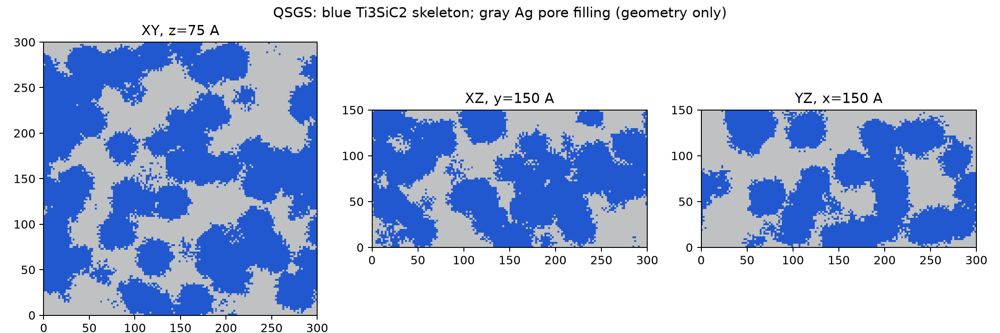
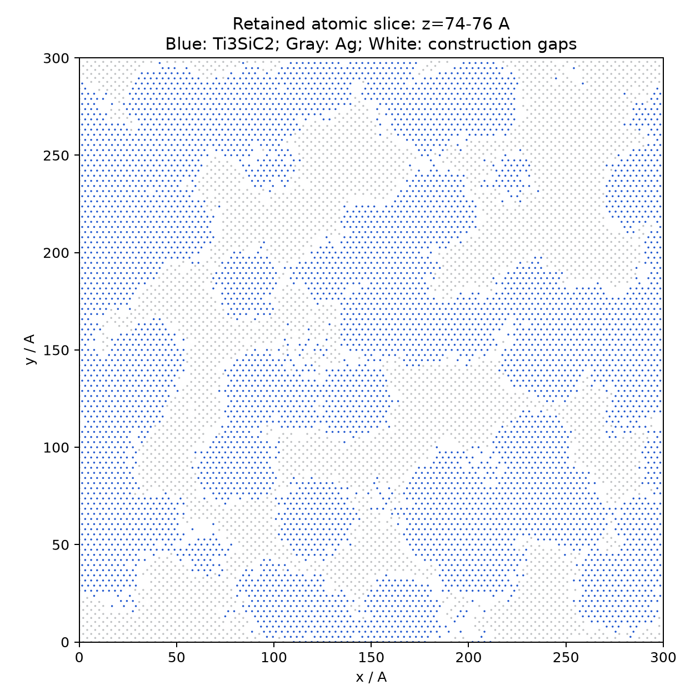

# QSGS Ag60/Ti₃SiC₂40 三维模型初版

## 模型

- 实体目标300×300×150 Å，模拟盒300×300×250 Å，上方100 Å真空。xy周期、z非周期。
- 911,834原子：Ti315411、Si103930、C207364、Ag285129。
- 实际Ag质量分数59.9964106%，骨架其余40.0035894%。晶体切割后的骨架元素比Ti:Si:C约3.0348:1:1.9952，表面/界面截断造成偏离理想3:1:2，未伪称精确化学计量。
- 固定层0≤z<10 Å，恒温层10≤z<25 Å，牛顿层25≤z≤150 Å。层分组按初始原子位置定义；顶面不是动态热源边界的已验证实现。
- 300×300×150是近似设计目标，后续可按晶格和原子数适当缩小；本交付仍是上述尺寸。当前TSC横向应变+0.122%、−0.615%，Ag横向+0.479%。调整高度后须同步修改热源顶面与电子网格。

## 生成与审计

使用新实现的QSGS随机种子-方向概率生长：2 Å体素，种子20261021，核心概率0.0002，面生长概率0.18，面/边/角权重1、2/3、4/9；目标相体积分数通过保留原子的实际质量标定。不是高斯随机场，也不是从二维图片拉伸。参数是本次明确选择的建模假设，不是从旧仓库找回的四参数表。

骨架由COD9009647 Ti₃SiC₂晶格构造，c轴沿z。Ag为a=4.09 Å的FCC；移除距骨架小于2.20 Å的Ag界面候选位点，未进行受力弛豫。界面规则会产生原子级空隙，不能声称无孔隙或机械稳定。

TSC在2.75 Å邻接阈值下最大分量99.3798%，3887原子在小分量中；Ag在3.2 Å阈值下最大分量99.6977%，862原子在小分量中。两相最大分量都具有xy周期绕行和z贯通。是具有双贯通主网络的几何初版，尚未消除所有孤立原子簇，也未做邻接阈值敏感性分析。原始分量如实保留。

三维图和QSGS切片显示生成体素形貌，不是原子受力或烧蚀结果；ATOMIC_XY_SLICE.png显示实际保留原子的z=74–76 Å薄层，白色为构造间隙。三维骨架表面图为4 Å采样预览。

## 文件和重现

MODEL_DATA.tar.gz含LAMMPS atomic data（1Ti、2Si、3C、4Ag）、ASE/OVITO extxyz（phase_id:1骨架2Ag；layer_id:1固定2恒温3牛顿）、逐原子分组CSV及QSGS生长场。解压：`tar -xzf MODEL_DATA.tar.gz`。

生成器：`OPENBLAS_NUM_THREADS=1 OMP_NUM_THREADS=1 MPLCONFIGDIR=/workspace/.cache/matplotlib /workspace/envs/gpaw/bin/python build_qsgs.py`，所需numpy/scipy/ase/matplotlib。绘图还需scikit-image，运行render_model.py。脚本会重建model/下同名生成输出，需在新目录重现并保留用户已有文件。本次运行的日志和几何审计已一并提供。

势文件calibration-v0来自提交0530b99，Ag EAM + TSCBOP + Ag–TSC Morse；未使用MACE检查点。仅复制势文件，尚未执行run 0、最小化、平衡或TTM；本模型不具备已验证的加热就绪状态。后续先审阅形貌及界面/孤立簇，再进行势函数下的数值检查。
