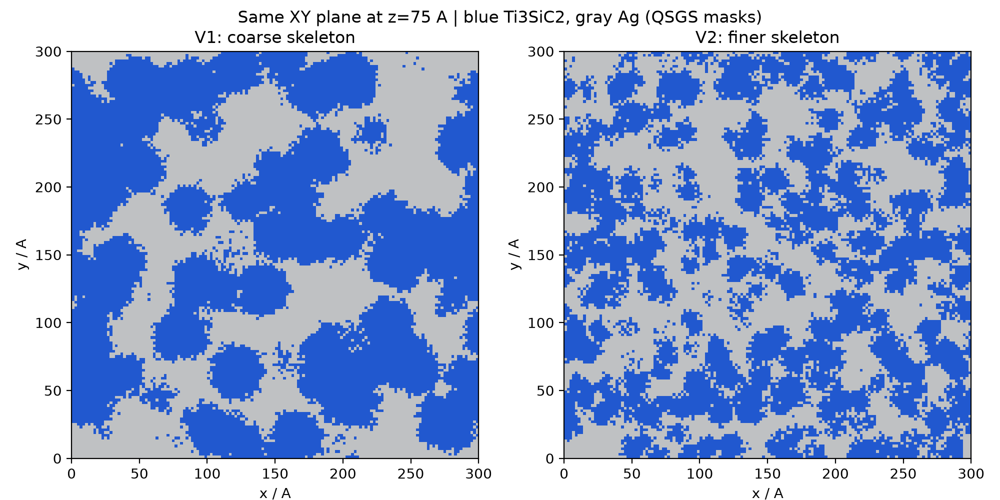
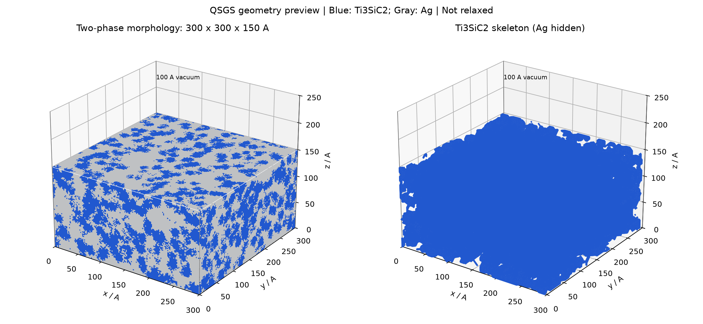
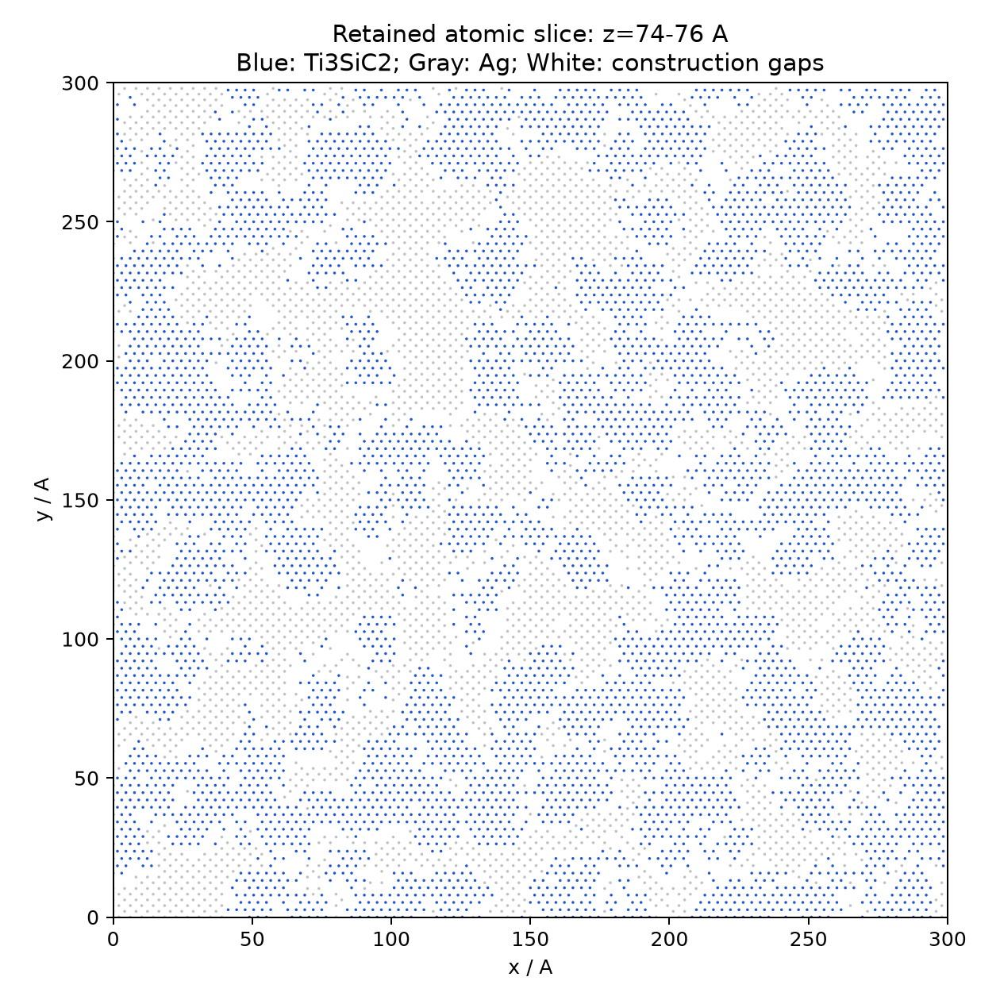

# QSGS细化版 V2：Ag60/Ti₃SiC₂40

根据“再细一点”的要求，将核心分布概率从0.0002提高至0.0016（8倍），其余生长概率、方向权重、随机种子、体素分辨率及母晶格保持一致；再次按最终保留原子质量标定60/40。没有将旧几何直接缩放。

- 实体300×300×150 Å，上方100 Å真空，xy周期/z非周期。当前尺寸未缩小。
- 原子数821,958，Ag257130，Ti₃SiC₂骨架564828。实际Ag质量分数60.0069954%，骨架39.9930046%。
- 分层仍为0–10 Å固定、10–25 Å恒温、25–150 Å牛顿。
- 体素骨架内到相界面的平均距离由5.63 Å降至2.89 Å；这只是比较细化程度的距离指标，不是局部骨架直径或弛豫后的厚度。
- TSC在2.75 Å邻接阈值下主分量98.7049%（7315原子在小分量）；Ag在3.2 Å阈值下主分量99.0810%（2363原子在小分量）。两个主分量均有xy周期绕行及z方向贯通。小分量比例比V1增大，不声称全部原子属于同一网络。
- 为避免跨相重叠，移除距骨架小于2.20 Å的Ag候选位点。细化提高界面面积，按此规则删除的位点增多，故相同外形尺寸下原子数减少；不能把原子数下降解读为实体尺寸缩小。白色原子切片区域为构造间隙。
- 这是新选择参数的QSGS几何初版；形貌预览为体素场，不是MD结果。Ti/Si/C切割后计量比及晶格应变详见GEOMETRY_AUDIT.json。

MODEL_DATA.tar.gz含LAMMPS data、OVITO/ASE extxyz、逐原子分组、QSGS生长场。LAMMPS类型1Ti、2Si、3C、4Ag；extxyz phase_id=1骨架、2Ag；layer_id=1固定、2恒温、3牛顿。

重现：解压`tar -xzf MODEL_DATA.tar.gz`可查看现有结构；在干净输出目录用Python3.12及numpy/scipy/ase/matplotlib运行build_qsgs.py，绘图额外需scikit-image。compare_versions.py需先将本目录及相邻V1目录的压缩包各自解压，读取两版生长场。脚本会写model/输出，保留已有用户文件，勿盲目覆盖。

保留calibration-v0势文件，未读MACE检查点，未做势函数下run0、弛豫、平衡或TTM加热。当前交付用于审阅形貌与连接性；正式计算前还需处理/评估孤立簇、界面构造和数值稳定性。
